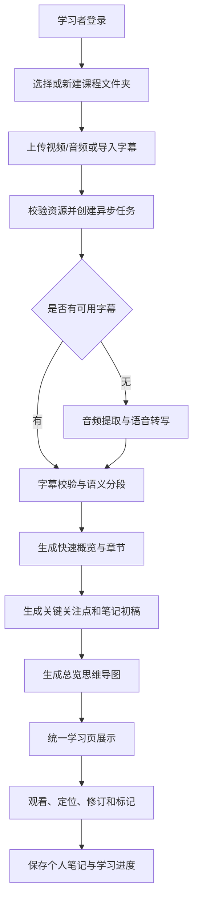

# 课览 CourseLens

> 面向视频课程的智能预习与可编辑笔记工作台。
>
> **先览全课，再学重点。**

课览（CourseLens）帮助学习者把自己有权处理的视频、音频或字幕资料，转化为课程概览、章节结构、关键关注点、带时间定位的 AI 笔记初稿和思维导图。学习者无需一边播放一边频繁暂停抄写，而是在 AI 初稿上核对、补充和修订，把注意力放在理解原理、判断准确性和形成个人认识上。

| 选题要素 | 说明 |
| --- | --- |
| 项目名称 | 课览 CourseLens |
| 项目简介 | 覆盖课程导入、异步处理、课前预览、AI 笔记、思维导图和个人修订的视频学习工作台 |
| 业务背景 | 视频课程按时间线性呈现，学习者课前难以了解全貌，观看时频繁暂停抄写会打断思考，课后笔记又难以定位原视频核对 |
| 目标用户 | 学习高校课程、公开课、技术教程和岗位培训视频的学生、自学者与职业学习者；管理员负责保障用户、资源和处理任务正常运行 |

**作业记录：**[Week 02：项目选题与功能规划](docs/homework/week-02/index.md) · [Week 03：Spring Boot 工程与运行验证](docs/homework/week-03/index.md) · [Week 04：业务建模、API、数据库与测试](docs/homework/week-04/index.md) · [项目选题简案](docs/project-proposal.md)

---

## 1. 项目背景

在线视频课程具有时长长、信息线性呈现、重点分布不均等特点。传统学习方式通常是“播放视频 → 遇到重点暂停 → 抄录内容 → 恢复播放 → 课后再次整理”。这种方式存在以下问题：

- 看视频前不了解课程主题、难度、章节结构和重点，难以判断是否值得学习以及需要投入多少时间；
- 观看过程中频繁暂停记录，注意力不断在“抄写”和“理解”之间切换，难以连续思考知识原理；
- 大部分情况下只是先把内容抄下来，再进行记忆和理解，学习效率明显下降；
- 课后笔记零散，发现疑问时难以快速返回视频对应片段核对；
- 转写和 AI 内容生成耗时较长，需要明确的处理进度、失败原因和重试机制。

课览的目标不是代替学习者学习，而是把“从零抄写”转变为“基于可靠初稿进行理解、核对、修订与补充”，形成“**预览 → 观看 → 修订 → 复习**”的学习闭环。

### 1.1 选择该题目的原因

1. **来自真实学习需求**：网课学习中的课前不了解内容、暂停抄写和笔记难复用是高频问题；
2. **业务价值明确**：项目重点是提高预习、理解与笔记整理效率，而不是简单保存或播放视频；
3. **角色与流程足够丰富**：包含学习者、管理员和内容处理组件，覆盖资源、任务、内容、修订、共享与审计；
4. **适合持续演进**：可从模块化单体开始，后续逐步加入数据库、认证、消息、服务拆分、事务、监控和部署；
5. **范围可以控制**：第一阶段使用本地文件和字幕输入，避免多平台下载、版权和反爬问题掩盖核心业务。

---

## 2. 项目目标与适用场景

### 2.1 核心目标

1. **课程预览**：正式观看前，让学习者了解课程讲什么、适合谁、章节如何组织、重点在哪里；
2. **笔记提效**：自动生成带来源定位的结构化笔记初稿，学习者只需修订、补充和标注个人理解；
3. **结构总结**：自动生成课程思维导图，帮助建立整体知识框架并用于课后复习；
4. **过程可控**：让转写和内容生成任务可查询、可重试、可恢复、可审计；
5. **持续演进**：保证后续课程要求可以在同一项目上逐步实现，而不需要更换题目。

其中，**课前预览和 AI 笔记初稿并列为最高优先级，思维导图为次级核心价值**。

### 2.2 适用场景

- 学生预习和学习高校课程、公开课及考试辅导视频；
- 开发者学习技术教程、框架讲解和项目实战视频；
- 职业学习者整理岗位培训、行业课程和会议回放；
- 学习者处理自己录制或已经获得处理权限的视频、音频与字幕资料。

---

## 3. 用户角色与需求

| 角色 | 核心需求 | 主要职责与权限 |
| --- | --- | --- |
| 学习者 | 看课前掌握课程框架，减少抄写时间，形成可复习的个人笔记 | 上传并归类课程；查看概览、章节、笔记和导图；编辑个人笔记；定位原视频；按需共享内容；管理学习标记 |
| 管理员 | 保障账号、资源和异步任务正常运行 | 查看任务状态与失败原因；重试或终止异常任务；管理用户状态与资源；查看指标和审计记录 |
| 内容处理组件 | 将课程资源稳定转化为学习资料 | 以任务标识执行媒体预处理、转写、章节切分、概览/笔记/导图生成并回传状态 |

> 内容处理组件不是人类用户，但它是重要的业务参与方，用于体现异步任务、消息通信、失败补偿和后续服务拆分。

---

## 4. 核心业务流程



处理失败时，系统记录失败阶段、原因和尝试次数。暂时性网络或服务错误可自动重试，学习者和管理员也可按权限发起有限次数的人工重试。重试优先从已经成功的阶段继续，不重复执行不必要的转写，也不会覆盖学习者已经保存的个人修订。

### 4.1 统一学习页的信息顺序

统一学习页按以下顺序组织内容：

1. **快速概览**：课程主题、适合人群、前置知识、学习收获和预计投入；
2. **章节路线**：章节标题、时间范围、核心问题和主要知识点；
3. **关键关注点**：优先覆盖原理、难点、考试或实践价值、常见误区；
4. **课程笔记**：按章节生成的可编辑 AI 笔记初稿；
5. **总览导图**：以“课程—章节—知识点—细节”展示知识结构。

用户点击章节、笔记条目或导图节点时，可以跳转到关联的视频时间位置；没有时间戳依据的内容只显示文本来源，不伪造精确跳转。

---

## 5. 功能模块

### 5.1 用户与权限

| 功能 | 说明 |
| --- | --- |
| 注册与登录 | 支持学习者和管理员登录，恢复用户会话 |
| 角色权限 | 区分学习者与管理员操作范围 |
| 资源级授权 | 校验课程、任务、字幕、笔记和导图是否属于当前用户或已公开共享 |
| 操作审计 | 记录管理员重试、终止任务、账号管理和资源治理等敏感操作 |

### 5.2 课程资源管理

| 功能 | 说明 |
| --- | --- |
| 本地文件上传 | 上传自己有权处理的视频或音频，校验类型、大小、时长和上传状态 |
| 字幕文本导入 | 支持 SRT、VTT 和 UTF-8 文本，作为已有字幕输入或转写降级方案 |
| 文件夹归类 | 上传前选择或新建文件夹，课程可以移动；删除文件夹时课程回到“未分类” |
| 课程信息 | 维护标题、简介、标签、来源说明、封面、总时长和学习状态 |
| 分类与检索 | 按文件夹、标签、状态、创建时间和关键词查找课程 |

### 5.3 智能处理任务

| 功能 | 说明 |
| --- | --- |
| 任务创建 | 每次处理生成独立任务，并避免相同资源和配置被重复处理 |
| 异步执行 | 上传完成后进入处理队列，页面不阻塞等待模型返回 |
| 转写与分段 | 提取音频并转写，或校验导入字幕；按时间、语义和章节进行切分 |
| 状态反馈 | 展示等待、转写中、生成中、已完成和失败状态 |
| 失败重试 | 区分可重试与不可重试错误，记录失败阶段、尝试次数和终止原因 |
| 幂等控制 | 重复消息或请求不会产生多个同时生效的内容版本 |

### 5.4 课程预览

| 功能 | 说明 |
| --- | --- |
| 快速概览 | 展示主题、适合人群、前置知识、预计收获、总时长和整体摘要 |
| 章节路线 | 按章节展示标题、核心问题、知识点和视频时间范围 |
| 关键关注点 | 优先说明原理、理解难点、考试或实践价值和常见误区 |
| 来源追溯 | 章节和重点关联字幕片段或时间范围，方便核对 AI 内容 |
| 详情级别 | 后续支持精简、标准和详细三种展示密度 |

### 5.5 AI 辅助笔记

| 功能 | 说明 |
| --- | --- |
| 笔记初稿 | 按章节生成概念、解释、案例、步骤和易错点等结构化内容 |
| 自动重点 | AI 初稿自动用结构化粗体标识核心重点，用户可以调整或取消 |
| 时间戳关联 | 笔记块关联一个或多个字幕片段及时间区间，点击后可回看核对 |
| 个人修订 | 支持编辑、补充、删除、高光、下划线、波浪线、双横线、段落标注和疑问标记 |
| 初稿与个人版 | 分层保存 AI 初稿和个人修订，重新生成时不静默覆盖用户内容 |
| 对照与合并 | 后续支持同屏查看 AI 初稿与个人版，接受、拒绝或合并 AI 建议 |
| 版本与导出 | 后续支持差异查看及 Markdown 等格式导出 |

### 5.6 思维导图与复习

| 功能 | 说明 |
| --- | --- |
| 导图生成 | 生成“课程—章节—知识点—细节”层级化导图 |
| 内容联动 | 点击节点跳转到关联章节、笔记或视频时间位置 |
| 导图编辑 | 后续支持修改节点标题、说明和层级关系 |
| 学习标记 | 将知识点标为已掌握、待复习或不理解 |
| 复习清单 | 根据学习标记汇总个人待复习内容 |

### 5.7 社区共享与相关推荐

| 功能 | 说明 |
| --- | --- |
| 分层共享 | 课程默认私有；用户可分别选择共享 AI 生成内容或个人修订笔记 |
| 公开内容浏览 | 学习者可查看他人主动公开的概览、笔记和导图，但不能修改原作者内容 |
| 相关内容推荐 | 后续根据课程标题、章节、字幕知识点和内容向量推荐相关视频与笔记 |
| 隐私边界 | 只共享 AI 内容时不公开个人修订；原始媒体、私有文件夹和学习记录不随笔记共享 |
| 取消共享 | 取消后内容立即停止进入新的检索和推荐结果 |

### 5.8 管理与运营

| 功能 | 说明 |
| --- | --- |
| 用户管理 | 查看用户状态，禁用或启用异常账号并记录原因 |
| 任务管理 | 查看任务状态、耗时、失败阶段、失败原因和重试记录 |
| 资源治理 | 处理重复、异常或不合规的资源记录 |
| 通知中心 | 在任务完成、失败或重试结束后通知相关学习者 |
| 系统指标 | 展示任务成功率、平均耗时、失败类型和队列积压量 |

---

## 6. 当前范围与暂不实现内容

### 6.1 当前优先范围

- 用户有权处理的本地视频、音频上传和字幕文本导入；
- 异步处理任务、字幕/转写分段、处理进度和失败恢复；
- 快速概览、章节、关键关注点、AI 笔记和思维导图；
- 统一学习页、视频定位、个人修订和学习标记；
- AI 初稿与个人内容分层保存；
- 基础认证授权、管理员任务管理和操作审计。

### 6.2 暂不实现

- 不作为任意第三方平台视频下载器；
- 不绕过登录、会员、地区、版权或其他访问限制；
- 第一阶段不实现浏览器插件、桌面客户端、复杂 RAG 问答、模型微调或 GPU 集群；
- 不承诺 AI 输出完全正确，生成结果必须能够核对和修改；
- 不在未经授权的情况下将私人视频、笔记或风格示例用于公共模型训练；
- 成熟社区、复杂推荐和个性化输出风格在核心闭环稳定后逐步实现。

---

## 7. 后续课程演进方向

项目采用“**先完成可运行的模块化单体，再按稳定业务边界逐步服务化**”的策略。

| 课程方向 | 项目中的演进内容 |
| --- | --- |
| 数据库持久化 | 持久化用户、课程、任务、字幕片段、AI 版本、个人笔记、导图、共享策略和审计记录 |
| 认证与授权 | 登录认证、角色权限、资源级授权和管理员敏感操作审计 |
| 服务拆分 | 按用户权限、课程资源、任务处理、内容生成、学习内容和通知等边界拆分服务 |
| 消息通信 | 使用领域事件传递资源上传、转写完成、生成完成、任务失败和通知消息 |
| 事务一致性 | 通过任务状态机、幂等键、事件记录和失败补偿实现跨服务最终一致性 |
| 监控 | 采集任务成功率、耗时、失败类型、队列积压、存储容量、日志和链路追踪 |
| 部署 | 容器化部署应用、数据库、对象存储和消息组件，通过环境变量管理配置与密钥 |

后续可能拆分为用户权限服务、课程资源服务、任务处理服务、内容生成服务、学习内容服务和通知服务。服务拆分以业务边界和数据归属稳定为前提，不为了使用微服务技术而提前拆分。

---

## 8. 仓库信息

| 项目 | 内容 |
| --- | --- |
| 课程 | 微服务架构（Microservices Architecture） |
| 姓名 | 区恩善 |
| 学号 | 2420100402 |
| GitHub | [@enshanou](https://github.com/enshanou) |
| 仓库地址 | <https://github.com/enshanou/microservices-practice-2420100402> |

本仓库是《微服务架构》课程本学期唯一使用的个人实践仓库。后续作业将在同一项目中逐步完成需求分析、设计、实现、测试、部署与文档整理，所有变更通过 Git 提交记录留痕。

## 9. 目录结构

```text
.
├── README.md
├── docs/
│   ├── project-proposal.md
│   ├── database.md
│   └── homework/
│       ├── week-01/
│       │   ├── index.md
│       │   ├── submission.md
│       │   └── screenshots/
│       ├── week-02/
│       │   ├── index.md
│       │   └── screenshots/
│       ├── week-03/
│       │   ├── index.md
│       │   └── screenshots/
│       └── week-04/
│           ├── index.md
│           ├── evidence/
│           └── screenshots/
├── monolith/
│   ├── pom.xml
│   ├── mvnw
│   ├── mvnw.cmd
│   ├── .mvn/wrapper/
│   ├── scripts/
│   └── src/
└── src/
```

第 02 周重点是**确定项目选题和完成功能规划**，当周不要求完成 Java 代码。选题过程和完成内容见 [Week 02 作业记录](docs/homework/week-02/index.md)。

## 10. 当前工程与本机启动

`monolith/` 是独立 Maven 工程：Java 25、Spring Boot 4.0.8、Maven Wrapper 3.9.16、MySQL。主配置为 `src/main/resources/application.yml`，默认 HTTP 端口 8080。第 03 周的问候与健康接口保留；本周新增课程和任务管理。

### 本机最快运行方法

打开 Windows **PowerShell**，复制执行下面三行：

```powershell
cd 'D:\study\GitHub\microservices-practice-2420100402\monolith'
Set-ExecutionPolicy -Scope Process Bypass
.\scripts\Start-Local.ps1
```

看到 `Started CourseLensApplication` 后保持窗口打开。脚本会使用本机已有 MySQL 二进制，在 `D:\courselens-local-mysql` 准备独立数据库，监听 13306，然后启动应用。随机密码和真实数据库文件均保存在仓库外。重复启动保留课程和任务，不改动电脑原有 3306 服务。若 HTTP 8080 被占用，可改用 `.\scripts\Start-Local.ps1 -Port 18080`，后面的请求也相应改为 18080。

浏览器可打开：

- <http://localhost:8080/api/courses>：课程列表，JSON 是接口实际响应。
- <http://localhost:8080/api/hello>：`CourseLens is running`。
- <http://localhost:8080/actuator/health>：`{"status":"UP"}`。

停止应用：在启动窗口按 Ctrl+C，若出现 `Terminate batch job (Y/N)?` 输入 Y 回车。独立数据库仍运行；需要停止时，在应用退出后执行 `.\scripts\Stop-LocalMySql.ps1`，下次启动脚本会重新启动它。

### 两个可直接运行的 curl 示例

另开 PowerShell 窗口，进入 `monolith/` 执行（这里明确使用 `curl.exe`）：

```powershell
cd 'D:\study\GitHub\microservices-practice-2420100402\monolith'
curl.exe -i http://localhost:8080/api/courses
curl.exe -i -X POST http://localhost:8080/api/courses -H 'Content-Type: application/json' --data-binary '@scripts/requests/create-course.json'
```

第一条查询课程列表，返回 200；第二条从仓库内 JSON 文件读取课程输入并创建记录，返回 201 和新 UUID。使用文件传递 JSON 适用于 Windows PowerShell 的引号规则。macOS/Linux 将 `curl.exe` 换成 `curl`，在同一目录执行即可。

需要完整演示创建任务、拒绝重复任务、状态更新及历史查询时执行：

```powershell
.\scripts\Verify-Api.ps1
```

脚本检查 19 次真实 HTTP 请求；成功时显示 `SUCCESS: 19 HTTP checks passed`。每次生成新演示课程，保留成功和失败两条任务历史，方便再次查询。

### 新电脑安装 MySQL 与手动连接

1. 安装 JDK 25，并配置 `JAVA_HOME`；项目使用自带 Maven Wrapper，无须另装 Maven。
2. 按 [MySQL 官方 Windows 安装说明](https://dev.mysql.com/doc/refman/8.4/en/windows-installation.html) 安装 MySQL 8.4 LTS，记住安装时设置的 root 密码，确认 `mysql.exe` 可运行。本机已有版本是 8.0.45，已实际验证通过。
3. 若采用仓库初始化脚本，将 MySQL 的 bin 目录加入 PATH，或给 `.\scripts\Initialize-LocalMySql.ps1` 传入 `-MySqlBin 'D:\mysql\bin'`。它默认使用英文数据路径和独立端口 13306。在其他机器上执行 `Start-Local.ps1` 时传入真实 `-JdkHome`；脚本中的 Maven 缓存目录也可按需调整。
4. 若使用自己已经配置好的 MySQL 服务，在 `monolith/` 中打开 MySQL 命令行：

```powershell
mysql.exe -h 127.0.0.1 -P 3306 -u root -p
```

输入 root 密码后，在出现的 `mysql>` 中执行下面 SQL（先把项目账号密码替换为自己设置的密码，斜杠路径按实际仓库位置调整）：

```sql
SOURCE D:/study/GitHub/microservices-practice-2420100402/monolith/scripts/schema.sql;
CREATE USER IF NOT EXISTS 'courselens'@'localhost' IDENTIFIED BY 'replace-with-your-own-password';
GRANT SELECT, INSERT, UPDATE, DELETE ON courselens.* TO 'courselens'@'localhost';
SOURCE D:/study/GitHub/microservices-practice-2420100402/monolith/scripts/demo-data.sql;
EXIT;
```

若本机 MySQL 命令行不能识别中文 SOURCE 路径，将两份 SQL 复制到英文目录（例如 `D:/courselens-sql/`），再从该目录 SOURCE。示例数据脚本可以重复执行，不删除或覆盖已经存在的课程和任务。

在 PowerShell 配置连接后启动：

```powershell
$env:JAVA_HOME = 'D:\study\jdk-25\jdk-25.0.4.1+1'
$env:Path = "$env:JAVA_HOME\bin;$env:Path"
$env:MAVEN_USER_HOME = 'D:\study\maven-user-home'
$env:MAVEN_OPTS = '-Dmaven.repo.local=D:\study\maven-repository'
$env:DB_URL = 'jdbc:mysql://127.0.0.1:3306/courselens?serverTimezone=UTC&characterEncoding=UTF-8'
$env:DB_USER = 'courselens'
$env:DB_PASSWORD = Read-Host '输入刚才设置的 courselens 数据库密码' -MaskInput
.\mvnw.cmd spring-boot:run
```

`-MaskInput` 适用于 PowerShell 7；Windows PowerShell 5 可将最后的密码输入改为 `Read-Host`。连接 13306 时相应修改 URL。不要将真实密码写进 application.yml 或提交到 GitHub。生产 `ddl-auto: validate` 只校验结构，建表使用 SQL 脚本。详细字段、关系和约束见 [数据库文档](docs/database.md)。

### 自动测试（不需要 MySQL）

打开 PowerShell，在 `monolith/` 中设置上面的 JDK 与 Maven 环境（无需 DB 环境变量），然后执行：

```powershell
.\mvnw.cmd clean test
.\mvnw.cmd test
```

macOS/Linux 配置好 JDK 25 后使用 `./mvnw clean test` 与 `./mvnw test`。测试连接隔离的 H2，自动准备数据，不修改本地 MySQL。

## 11. 第四周已实现内容

本周实现“登记课程资料 → 创建处理任务 → 记录状态 → 查询历史”，与既有 CourseLens 选题保持一致。

| 方法 | 接口 | 功能 |
| --- | --- | --- |
| POST | /api/courses | 登记课程归属、标题、资料引用 |
| GET | /api/courses | 查询课程列表 |
| GET | /api/courses/{courseId} | 查询课程详情 |
| POST | /api/courses/{courseId}/tasks | 创建待处理任务 |
| GET | /api/courses/{courseId}/tasks | 查询课程任务历史 |
| GET | /api/tasks/{taskId} | 查询任务详情 |
| PATCH | /api/tasks/{taskId}/status | 更新为 RUNNING、SUCCEEDED 或 FAILED |

新增 Course 和 ProcessingTask 两类 JPA 实体、两个 Repository、一个 Service、两个 Controller，以及输入输出 DTO。Controller 仅处理 HTTP；Service 检查同一课程不能有多条未结束任务，并控制状态路径。事务、课程行锁和活动任务唯一键防止并发重复提交。任务结束可重试且保留历史；失败必须提供原因。

错误响应：输入错误 400、资源不存在 404、重复活动任务或非法状态转换 409。数据保存在 MySQL，应用重启仍可查询。

2026-10-12 实测：**31 项自动测试全部通过，clean test 后再运行 test 仍全部通过**；**19 项真实 HTTP 检查通过**；MySQL 写入、应用重启读取与历史查询通过；同时两次创建返回 201 和 409，活动任务只保存一条。

作业要求、原始证据、截图及四项可复制提交说明见 [Week 04 作业记录](docs/homework/week-04/index.md)。设计见 [项目选题简案](docs/project-proposal.md)，表结构见 [数据库文档](docs/database.md)。

当前资料引用只登记路径/来源，任务状态由调用方提交。文件上传、后台转写、AI 笔记生成、登录授权和学习页面仍属于后续功能。本周完成的是这些功能所需的课程与任务管理基础。
