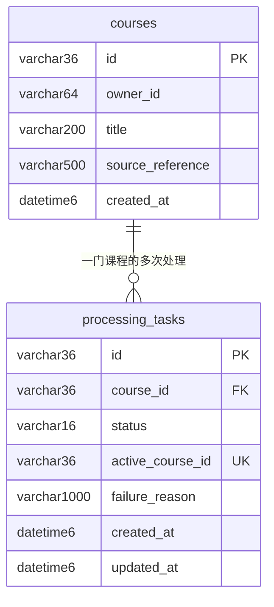

# CourseLens 第四周数据库设计与复现

## 实际环境与连接

运行库使用 MySQL，自动测试使用独立 H2 内存库。2026-10-12 在本机 MySQL **8.0.45** 上实测；连接地址 `127.0.0.1:13306/courselens`。电脑原有的 3306 服务保持不变。Java 25.0.4.1、Spring Boot 4.0.8、Maven Wrapper 3.9.16。

数据库文件、日志和随机生成的本机凭据位于 `D:\courselens-local-mysql`，不在 Git 仓库内。采用英文目录是为了兼容本机 MySQL 对中文配置路径的处理。应用账号 `courselens` 仅有该库的 SELECT、INSERT、UPDATE、DELETE 权限；建表由本地初始化脚本以独立实例的 root 完成。

新电脑可以安装 MySQL 8.4 LTS，或兼容的 MySQL 8.0.16+（需支持 CHECK 约束，参见 [官方约束说明](https://dev.mysql.com/doc/refman/8.0/en/create-table-check-constraints.html)）。安装步骤和手动配置见 [README](../README.md)。本次实测的版本是 8.0.45，不将其标记为 8.4。

## 表和关系



| 表 | 字段 | 必要约束与用途 |
| --- | --- | --- |
| courses | id | VARCHAR(36)，UUID 主键，由 JPA 生成 |
| courses | owner_id / title / source_reference | 非空，长度分别为 64 / 200 / 500；Service 同时检查不能为空白文本 |
| courses | created_at | DATETIME(6)，非空，应用按 UTC 保存创建时间 |
| processing_tasks | id | VARCHAR(36)，UUID 主键 |
| processing_tasks | course_id | 非空外键，指向 courses.id，禁止保存不存在课程的任务 |
| processing_tasks | status | 非空，CHECK 只允许 PENDING、RUNNING、SUCCEEDED、FAILED |
| processing_tasks | active_course_id | 可空唯一键；未结束时等于 course_id，结束时必须为 NULL |
| processing_tasks | failure_reason | 最长 1000；FAILED 必须有非空白原因，其他状态必须为 NULL |
| processing_tasks | created_at / updated_at | DATETIME(6)，非空，记录创建和最后状态变更时间 |

一门课程可以有多条历史任务；一条任务只能归属一门课程。`idx_tasks_course_created` 支持按课程查询处理记录。默认不级联删除课程历史，本周没有删除接口。

## 业务规则和并发保护

核心规则是“同一课程同一时刻最多有一条 PENDING 或 RUNNING 任务”。Service 在 READ_COMMITTED 事务内先锁定课程行，检查未结束记录，再写入新任务。Repository 通过 `@Lock(PESSIMISTIC_WRITE)` 请求数据库行锁；不同课程不共用全局 Java 锁。

数据库唯一键 `uk_tasks_active_course` 提供第二层保护：活动任务的 active_course_id 为所属课程 UUID，重复值无法保存；完成或失败后将它置空，[MySQL 唯一索引允许多个 NULL](https://dev.mysql.com/doc/refman/8.0/en/create-index.html)，从而保留多条结束记录。CHECK 约束限制状态、活动标识与失败原因的组合。任务状态更新也锁定目标任务行，由 Service 校验 `PENDING → RUNNING → SUCCEEDED/FAILED`，禁止直接完成未启动任务或修改结束任务。

实现依据：[Spring Data JPA 行锁](https://docs.spring.io/spring-data/jpa/reference/jpa/locking.html)、[Spring Boot SQL 数据源配置](https://docs.spring.io/spring-boot/4.0/reference/data/sql.html)。

## JPA 与输入对象

- `Course` 和 `ProcessingTask` 使用 `@Entity`，后者用 `@ManyToOne` 映射课程关系。
- 两个 Repository 位于 `com.zjgsu.oes.repository`，继承 `JpaRepository`；Controller 通过 Service 访问数据。
- 请求由 `CourseDtos.Create`、`ProcessingTaskDtos.UpdateStatus` 承载；响应使用独立 DTO，避免直接输出实体关系。
- 主配置采用 `ddl-auto: validate`，只检查表结构，不清空数据库。`open-in-view: false`，DTO 读取字段不依赖请求结束后的延迟加载。
- `DB_URL`、`DB_USER`、`DB_PASSWORD` 通过环境变量注入；Git 中没有数据库真实密码。

## 可重复准备数据

在 `monolith/` 内使用：

```powershell
.\scripts\Initialize-LocalMySql.ps1
```

脚本仅初始化自己管理的独立实例，执行 [schema.sql](../monolith/scripts/schema.sql) 和 [demo-data.sql](../monolith/scripts/demo-data.sql)。已存在数据目录时保留原数据；端口被其他实例占用时拒绝接管。重复导入只补齐固定 UUID 的示例课程和成功任务，不覆盖已修改数据、不删除用户课程。

测试配置位于 `src/test/resources/application.yml`，H2 使用随机数据库名和 `create-drop`，与真实 MySQL 隔离。API 和 Service 测试通过 `@Sql("/test-data.sql")` 在每个用例前准备可重复数据；Repository 用例使用事务回滚。测试自动完成准备，运行时不需要手动连接 MySQL。

## 实际数据库验证

1. 应用连接 MySQL，API 创建课程及 PENDING 任务；SQL 查询到相同 UUID。
2. 停止并重新启动 Spring Boot 应用，API 仍读回原课程和任务。
3. 原任务改为 SUCCEEDED，再创建第二条任务并记录 FAILED 和原因；SQL 查到两条历史，活动标识均为 NULL。
4. 两个 HTTP 请求同时为另一门课程创建任务，返回值分别为 **201 和 409**，SQL 查询活动记录数为 **1**。
5. MySQL 元数据查询确认主键、外键、唯一键及三个 CHECK 约束存在；初始化脚本在应用重启时重复执行，原数据保留。

可核对原始结果：[重启前 SQL](homework/week-04/evidence/mysql-before-restart.txt)、[重启后 SQL](homework/week-04/evidence/mysql-after-restart.txt)、[实际 HTTP 请求结果](homework/week-04/evidence/api-verification.json)。截图见 [数据库实测](<homework/week-04/screenshots/真实 MySQL 查询结果.png>)。
