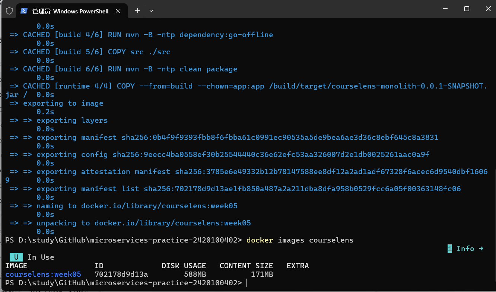
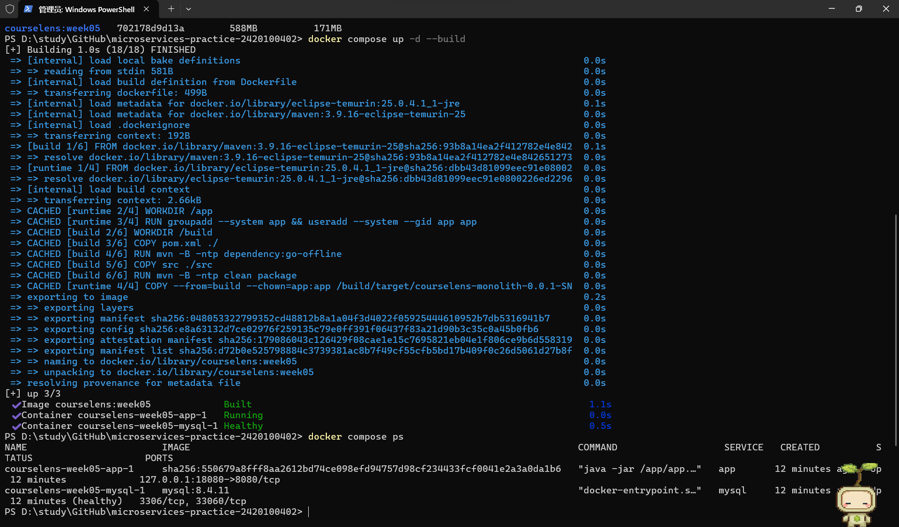
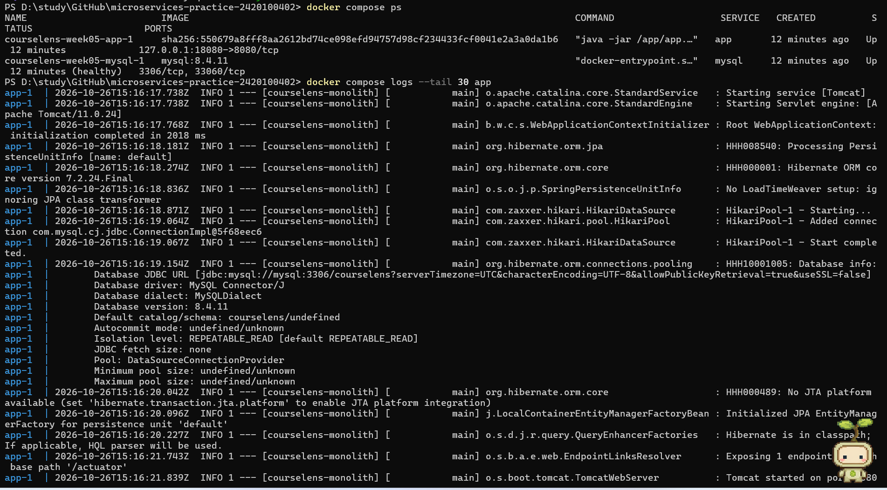
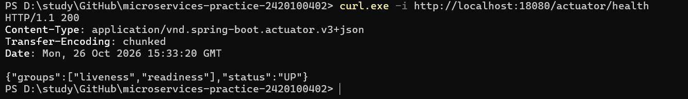
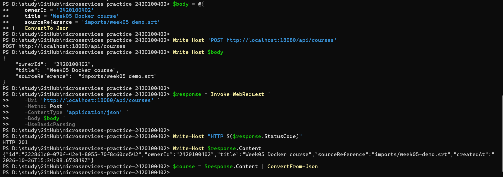
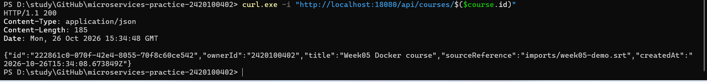
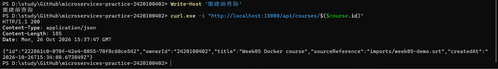
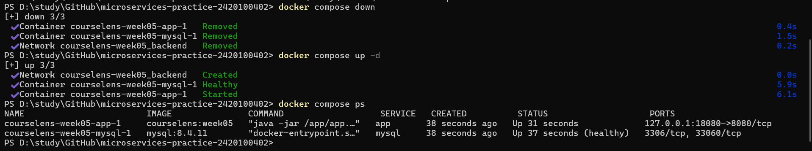
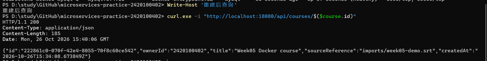

# Week 05：Spring Boot 与 MySQL 容器化

- 学号：2420100402
- 项目：课览 CourseLens，沿用 Week 04 的课程和处理任务业务。
- GitHub 仓库：https://github.com/enshanou/microservices-practice-2420100402
- 截图目录：[screenshots](screenshots/README.md)，已保存并核对 9 张本人操作截图。

**本次实测：镜像构建成功，31 项测试通过；app 和 MySQL 正常启动；19 项业务 HTTP 检查通过；删除重建容器后同一课程的 ID 与主要字段完全一致。** 详见 [实际验证记录](verification.md)。

## 1. 文件与配置

| 文件 | 作用 |
| --- | --- |
| `monolith/Dockerfile` | Maven / Java 25 构建、测试并打包；Java 25 JRE 运行可执行 JAR，使用普通用户 |
| `monolith/.dockerignore` | 排除 target、IDE、本地环境变量和密钥，不复制本机编译产物 |
| 根目录 `compose.yaml` | app 与 mysql:8.4.11，共享 backend 网络、健康依赖、端口映射和命名卷 |
| 根目录 `.env.example` | 端口、库名、账号、密码模板；实际 `.env` 已忽略，不提交 |
| `monolith/docker/init.sql` | 首次启动空数据卷时创建 courses、processing_tasks 表及约束 |
| `Verify-Week05.ps1` | 健康检查、创建/查询课程、删除并重建容器、对比持久化结果 |

## 2. 镜像构建

以下命令均在仓库根目录的 PowerShell 执行：

```powershell
docker build -t courselens:week05 ./monolith
docker images courselens
```

构建上下文为 `./monolith`。第一阶段使用 Maven 镜像执行依赖下载和 `mvn clean package`，包含项目测试；第二阶段只复制可运行 JAR，使用 JRE 启动。构建不依赖本机 Maven、Java 或 target 目录，运行镜像不带 Maven 和源代码。

## 3. Compose 编排与启动

首次配置（已有 `.env` 时保留原文件）：

```powershell
if (-not (Test-Path .env)) { Copy-Item .env.example .env }
notepad .env
# 将两个密码占位符改为不同的自设密码并保存，再启动。
docker compose config --quiet
docker compose up -d --build
docker compose ps
docker compose logs --tail 80 app mysql
```

app 将容器 8080 端口映射到本机 `127.0.0.1:18080`（由 APP_PORT 修改）。容器通过数据库服务名 `mysql:3306` 连接 MySQL，连接 URL、账号和密码由环境变量传入。数据库不向宿主机暴露端口。MySQL 使用业务账号执行 `SELECT 1` 健康检查，app 等待 `service_healthy` 后启动。应用沿用 Hibernate `ddl-auto: validate`，由初始化 SQL 建表。

```powershell
# 停止并删除容器、网络，保留数据库命名卷
docker compose down
# 再次启动
docker compose up -d
```

Compose 没有使用已废弃的 `version` 字段。实际密码仅保存在本地 `.env`，不要上传或截图展示。

## 4. 个人业务 API 验证

下面请求对应上一周已有的真实业务接口。健康接口应返回 HTTP 200 和 `status: UP`；创建课程应返回 HTTP 201、自动生成的 ID；按 ID 查询应返回 HTTP 200 和相同字段。

```powershell
$baseUrl = 'http://localhost:18080'
Invoke-WebRequest "$baseUrl/actuator/health" -UseBasicParsing | Select-Object StatusCode, Content
$body = @{ownerId='2420100402'; title='Week05 Docker course'; sourceReference='imports/week05-demo.srt'} | ConvertTo-Json
$response = Invoke-WebRequest "$baseUrl/api/courses" -Method Post -ContentType 'application/json; charset=utf-8' -Body ([Text.Encoding]::UTF8.GetBytes($body)) -UseBasicParsing
$response | Select-Object StatusCode, Content
$course = $response.Content | ConvertFrom-Json
Invoke-WebRequest "$baseUrl/api/courses/$($course.id)" -UseBasicParsing | Select-Object StatusCode, Content
```

需要覆盖上一周更多业务和异常流程时，可运行已有验证脚本：

```powershell
powershell -ExecutionPolicy Bypass -File .\monolith\scripts\Verify-Api.ps1 -BaseUrl http://localhost:18080
```

## 5. 数据持久化验证

```powershell
powershell -ExecutionPolicy Bypass -File .\docs\homework\week-05\Verify-Week05.ps1
```

脚本依次等待健康接口 UP、创建课程、查询并保存重建前 JSON、执行 `docker compose down`、执行 `docker compose up -d`、等待恢复、查询原课程 ID，并逐项对比 id、ownerId、title、sourceReference、createdAt。任何状态码或字段不符都会报错。

`mysql_data` 命名卷挂载到 `/var/lib/mysql`，完整卷名为 `courselens-week05_mysql_data`。容器删除后卷仍然存在，新容器重新挂载原卷，因此原记录应保持不变。初始化 SQL 只在空卷首次启动执行，不会覆盖已有数据。本次验证不可使用 `docker compose down -v`，该命令会删除数据卷。

验证响应保存在 [evidence/course-before.json](evidence/course-before.json) 和 [evidence/course-after.json](evidence/course-after.json)。实际执行结果另见 [验证记录](verification.md)。

## 6. 作业系统填写

仓库地址填写上述完整公开 GitHub 链接。以下为已验证的各栏目说明，截图见下一节：

1. 镜像构建：使用 Docker 多阶段构建，第一阶段在 Maven 镜像中完成测试和打包，第二阶段只保留 JRE 与可运行 JAR，镜像名为 courselens:week05。
2. 编排启动：使用 Compose 启动应用与 MySQL 8.4.11，应用通过 mysql 服务名连接数据库，账号密码来自环境变量，并等待数据库健康后启动。
3. 业务 API：通过本机 18080 端口检查健康接口，调用 POST /api/courses 创建课程，再用 GET /api/courses/{id} 查询，核对状态码及返回字段。
4. 持久化：创建课程后执行 docker compose down 和 up -d 重建容器，按原 ID 再次查询并比较主要字段，通过命名数据卷保留 MySQL 数据。

## 7. 本人截图与验证结果

### 7.1 镜像构建

在仓库根目录执行 `docker build -t courselens:week05 ./monolith`，成功导出镜像；`docker images courselens` 显示镜像名称及标签。截图中的 CACHED 表示复用了已有构建层，首次完整构建及 31 项测试通过的记录见 [构建日志](evidence/compose-build.txt)。重复构建可能产生不同的镜像清单 ID，镜像名称与标签保持为 `courselens:week05`。



### 7.2 Compose 启动

执行 `docker compose up -d --build` 后，app 正常运行，MySQL 8.4.11 健康；映射地址为 `127.0.0.1:18080`。日志显示通过 `mysql:3306/courselens` 连接数据库并启动 Tomcat。





### 7.3 健康、创建和查询

健康请求返回 HTTP 200 / UP。创建课程时提交 ownerId `2420100402`、title `Week05 Docker course`、sourceReference `imports/week05-demo.srt`，返回 HTTP 201；按返回 ID 查询，得到 HTTP 200 和相同字段。

本人截图记录的课程 ID 为 `222861c0-070f-42e4-8055-70f8c60ce542`，创建时间为 `2026-10-26T15:34:08.673849Z`。它与自动验证脚本创建的课程是两次独立测试，均保存在数据库中。







### 7.4 容器重建与数据保留

先查询上述课程并记录返回值，再执行 `docker compose down` 删除 app、mysql 容器及网络，未加 `-v`。执行 `docker compose up -d` 重建容器，MySQL 恢复健康后 app 启动。再次查询原 ID，返回 HTTP 200，id、ownerId、title、sourceReference、createdAt 均与重建前一致。







## 8. 按评分标准核对

| 项目 | 核对结果 | 证据 |
| --- | --- | --- |
| Dockerfile 与镜像构建（25%） | Maven 构建、JRE 运行的多阶段镜像；忽略构建产物、IDE 和密钥；完整构建测试通过 | Dockerfile、.dockerignore、构建日志、截图 01 |
| Compose 编排与启动（30%） | app + MySQL 8.4.11；上下文 ./monolith；共享网络、服务名连接、环境变量、命名卷、健康依赖；无 version 字段 | compose.yaml、.env.example、.gitignore、截图 02～03 |
| 业务 API 验证（20%） | 健康 200/UP；课程创建 201、查询 200；19 项业务 HTTP 检查通过 | README 命令、验证日志、截图 04～06 |
| 数据持久化验证（15%） | down / up -d 重建容器后，同一课程 ID 与主要字段不变 | 前后 JSON、验证日志、截图 07～09 |
| 文档与证明材料（10%） | 根 README 与本页提供可执行命令；9 张截图及完整验证记录已归档 | 本页、verification.md、screenshots/、evidence/ |

上述为要求覆盖情况，最终评分由老师评定。实际 `.env` 不进入 Git 提交，公开仓库仅提供环境变量模板。
