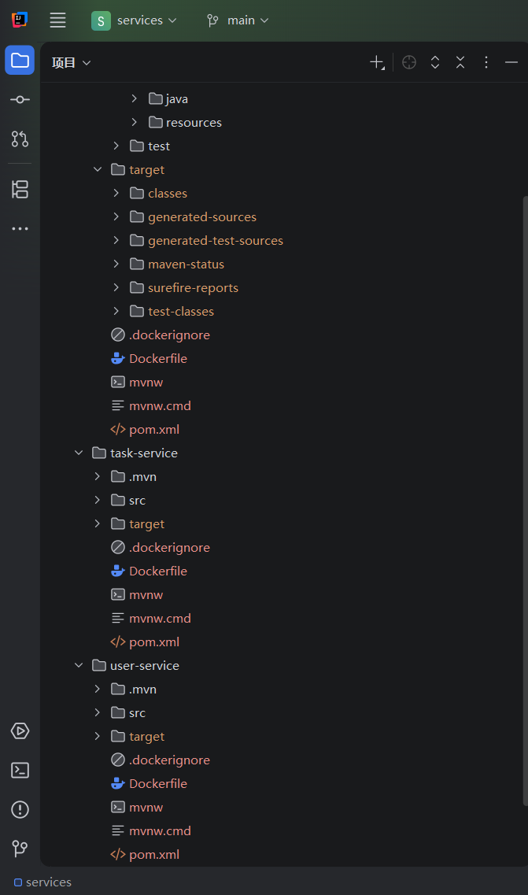
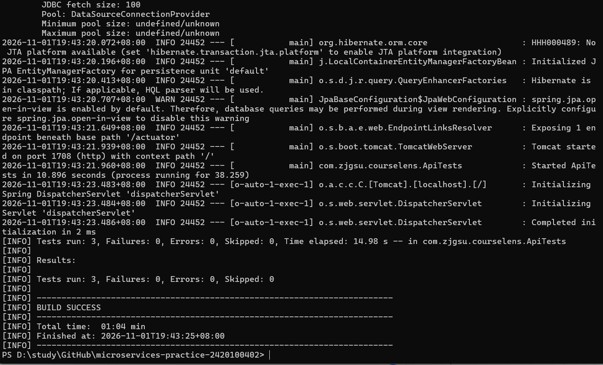
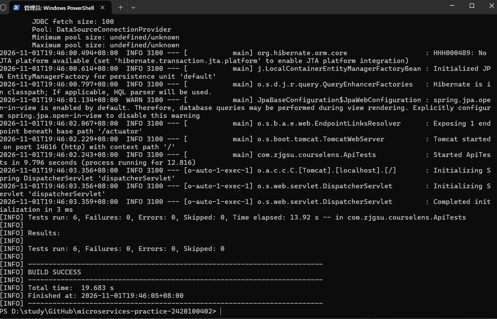
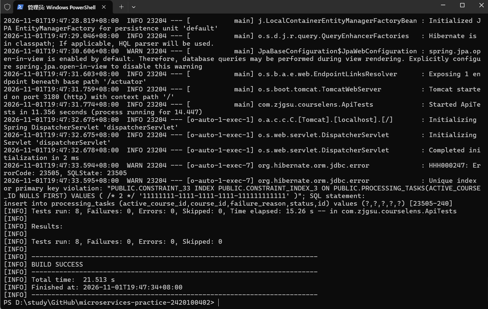
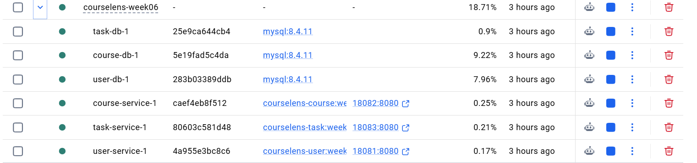
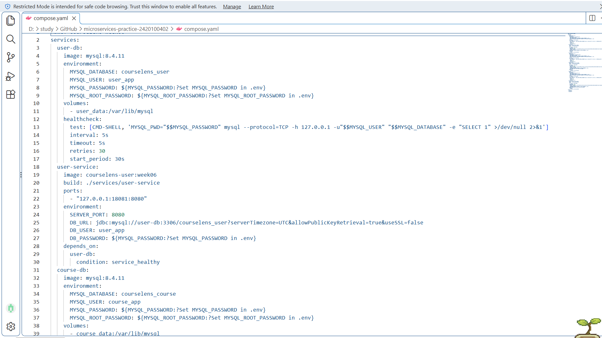
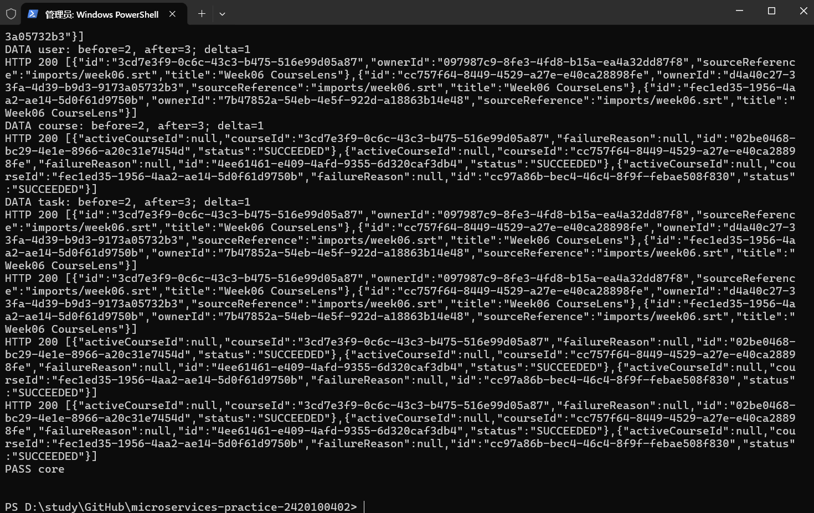
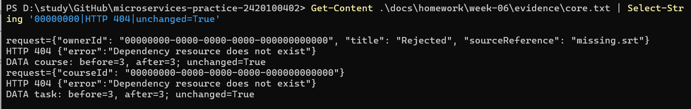
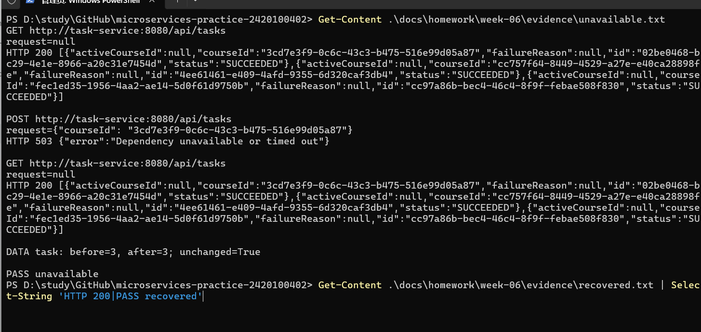

# Week 06：CourseLens 微服务拆分与本地编排

- 学号：2420100402
- 仓库：https://github.com/enshanou/microservices-practice-2420100402
- 设计：[服务边界、数据归属、Mermaid 架构及顺序图](../../microservices-design.md)
- 截图：[本人截图操作指南](screenshots/README.md)。已归档 9 张本人手动截图，见下方各小题的证据。
- 实测结果：[verification.md](verification.md)，原始输出见 [evidence](evidence/)。

## 1. 服务拆分设计

沿用前几周的课览课程处理业务，把用户、课程和处理任务划分为三个服务。用户服务补齐原先 ownerId 的用户资源归属，课程服务独立维护课程，任务服务只保存课程 ID。服务通过 HTTP 获取其他服务的信息，不跨库查询、不建立跨库外键。设计文档给出原单体模块映射、端口、数据库、表归属、调用关系和 Mermaid 图。

查看 `docs/microservices-design.md` 与 `services/`，对照三个独立 Controller、Service、Repository 及 SQL，确认没有引用其他服务的 Java 包。数据库写入分属三个 MySQL 实例；不是将同一单体换三个端口运行。

## 2. 代码拆分

三个目录分别为 `services/user-service`、`services/course-service`、`services/task-service`。每个服务可独立通过 Wrapper 构建，也可完全在 Docker 内执行测试、打包和运行。各自 application.yml 定义数据库、端口和依赖服务地址。

| 服务 | HTTP API |
| --- | --- |
| user-service | POST /api/users；GET /api/users；GET /api/users/{id} |
| course-service | POST /api/courses；GET /api/courses；GET /api/courses/{id} |
| task-service | POST /api/tasks；GET /api/tasks；GET /api/tasks/{id}；PATCH /api/tasks/{id}/status |
| 每个服务 | GET /actuator/health |

示例请求体：用户 `{"displayName":"2420100402"}`；课程 `{"ownerId":"用户UUID","title":"微服务课程","sourceReference":"imports/demo.srt"}`；任务 `{"courseId":"课程UUID"}`；状态更新 `{"status":"RUNNING"}`，之后 `{"status":"SUCCEEDED"}`。失败状态必须附带 failureReason。

各服务集成测试使用 H2 验证本地数据；课程、任务测试启动真正的本机 HTTP 服务器，验证 RestTemplate 的成功、404、5xx、读取超时，检查失败后表行数为零。任务测试另覆盖重复任务 409、非法流转、失败原因以及终态释放活动槽位。

```powershell
# 已有 Java 25 时可在根目录运行；无需本地 Maven
$env:JAVA_HOME='D:\study\jdk-25\jdk-25.0.4.1+1'
$env:Path="$env:JAVA_HOME\bin;$env:Path"
$env:MAVEN_USER_HOME='D:\study\maven-user-home'
$env:MAVEN_OPTS='-Dmaven.repo.local=D:\study\maven-repository'
foreach ($service in 'user','course','task') {
    & ".\services\$service-service\mvnw.cmd" -f "services/$service-service/pom.xml" -B -ntp test
    if ($LASTEXITCODE -ne 0) { throw "$service tests failed" }
}
```

## 3. 本地编排

根目录 `compose.yaml` 一键启动三个服务和三个 MySQL 8.4.11 实例。各实例初始化专用数据库和专用业务账号，应用启动时用自己的 schema.sql 建表，再由 Hibernate validate 校验。账号名分别是 user_app、course_app、task_app；为方便本地作业共用 .env 中的业务密码，但实例和账号权限隔离。

```powershell
Set-Location 'D:\study\GitHub\microservices-practice-2420100402'
# 沿用已有 .env。首次使用时从 .env.example 复制并填写两个密码。
if (-not (Test-Path .env)) { Copy-Item .env.example .env; notepad .env }
docker compose config --quiet
docker compose up -d --build
docker compose ps
```

服务在容器内使用 `user-db`、`course-db`、`task-db` 访问数据库，通过 `user-service`、`course-service` 调用依赖，不使用 localhost 指向其他容器。本机访问端口依次是 18081、18082、18083。数据库不发布宿主机端口。user_data、course_data、task_data 三个命名卷保留数据，`down` 再 `up -d` 不会丢失；不要使用 `down -v`。

前一周原编排另存为 `compose.week05.yaml`，保留原项目名和 mysql_data 卷。复现 Week 05 时使用 `docker compose -f compose.week05.yaml ...`；两周采用不同项目名和端口，可以分别管理。

## 4. 验证

```powershell
# Windows PowerShell：覆盖健康、完整流程、依赖不存在和不可用，并自动恢复依赖
powershell -ExecutionPolicy Bypass -File .\docs\homework\week-06\Verify-Week06.ps1
# 另验证删除重建容器后的数据保留
powershell -ExecutionPolicy Bypass -File .\docs\homework\week-06\Verify-Week06.ps1 -Persistence
```

```bash
# Linux / macOS / Git Bash，从仓库根目录运行题目要求的脚本
bash scripts/smoke-test.sh
```

两种入口共用 `scripts/smoke-test.py`。Python 在临时 python:3.13-alpine 容器中运行，无需本机安装 Python。首次执行会拉取镜像。检查脚本实际断言 HTTP 状态、任务终态和列表行数变化；任一步失败返回非零。脚本会新增演示记录，并短暂停止 course-service 测试故障；即使测试失败也尝试恢复该服务。请在本地作业环境执行，避免同时进行其他写入影响行数比较。

| 场景 | 请求和预期状态 | 数据变化 |
| --- | --- | --- |
| 健康 | 三个 /actuator/health → 200 / UP | 不变 |
| 顺序成功 | 创建用户 201 → 校验用户并创建课程 201 → 校验课程并创建任务 201；RUNNING → SUCCEEDED 各 200 | 三张表各增加 1；任务终态 SUCCEEDED |
| 重复活动任务 | 再次创建同一课程任务 → 409 | 无额外任务 |
| 用户不存在 | 课程引用全零 UUID 用户 → 404 | courses 数量不变 |
| 课程不存在 | 任务引用全零 UUID 课程 → 404 | processing_tasks 数量不变 |
| 课程服务不可用 | stop course-service 后提交真实课程的任务 → 503 | processing_tasks 数量不变 |
| 容器重建（可选增强） | down 后 up -d，按原 ID 查询 → 200 | 原用户、课程和 SUCCEEDED 任务仍在 |

自动运行记录包含实际请求、状态码、响应 JSON、数据数量前后比较；真实 UUID 见 evidence/context.json。测试前后不清空已有数据，只检查本次变化。

远端查询返回 200 后，本地数据库仍可能写入失败，例如重复活动任务触发唯一约束得到 409。因此远端成功不代表整个调用已成功。当前流程先验证再写入，依赖 404/503 时阻止本地落库；已成功创建的用户和课程不自动回滚。本周只验证顺序流程和基本失败处理，没有实现跨服务原子事务、自动补偿或消息。详细分析见设计文档。

## 5. 作业系统填写文本

服务拆分设计：沿用课览 CourseLens，将系统拆为用户、课程、处理任务三个独立服务，明确每个服务的职责、端口、数据库及表归属；跨服务仅保存 ID，通过 HTTP 校验资源，设计文档包含单体映射、架构图、调用顺序和一致性窗口分析。

代码拆分：三个独立 Spring Boot 应用各有配置、Controller、Service、数据库和集成测试，使用 RestTemplate 完成用户和课程校验，覆盖正常响应、资源不存在和依赖故障，失败时禁止写入本地数据。

本地编排：根目录 Compose 启动三个应用和三个 MySQL 实例，各自专用数据库、账号和持久化卷，通过 Compose 服务名通信，应用等待自身数据库健康后启动。

验证：使用仓库根目录 smoke-test.sh 或 Windows 等价脚本，检查三个健康接口，完成创建用户、课程和任务的顺序流程，校验缺失依赖返回 404、服务不可用返回 503及失败后的数据数量不变。

上述文本对应本页的实际实现、验证日志和本人截图，可用于作业系统填写；截图还需在作业系统对应小题中上传。


## 6. 本人截图与按要求核对

以下 9 张图片由本人手动截取。配置图原文件名误带一个反引号，归档时仅修正文件名，未编辑图片。

### 6.1 代码拆分（4 张）

三个服务具有独立构建文件和代码目录。结构图上方未完整显示课程服务名称，完整目录以仓库 `services/` 为准。三个测试截图分别显示 3、6、8 项测试成功，失败和错误均为 0。









### 6.2 本地编排（2 张）

运行图显示三个数据库和三个应用运行中，以及 18081/18082/18083 端口映射。数据库的 healthy 状态另见 [Compose 实际输出](evidence/compose-ps.txt)。配置图展示用户库、账号、数据卷及通过 user-db 连接的 URL，并展示课程库配置的开头；三个服务的完整配置以根目录 compose.yaml 为准。





### 6.3 验证（3 张）

成功图显示三类数据各增加 1、任务状态 SUCCEEDED 和 PASS core；该图未截入健康接口部分，三服务健康 200 / UP 的请求与响应见 [完整本轮日志](evidence/core.txt) 和 [提交前健康复核](evidence/final-health.txt)。缺失依赖图显示两次 404、课程和任务数量不变；不可用图显示 503、任务数量不变和 PASS unavailable。恢复结果见 [恢复日志](evidence/recovered.txt)。







### 6.4 作业要求核对表

| 作业项 | 检查结果 | 主要文件及证据 |
| --- | --- | --- |
| 服务拆分设计 | 三个服务；单体映射、职责、端口、独立库及表、调用关系、Mermaid 图齐全 | docs/microservices-design.md、第 1 节 |
| 代码拆分 | 独立 pom.xml、配置、Controller、Service、测试；RestTemplate HTTP 校验；地址可覆盖；连接和读取超时；失败阻止写入 | services/、17 项测试日志、4 张截图 |
| 本地编排 | 三个应用和三个 MySQL；独立库及账号；命名卷；服务名通信 | compose.yaml、数据库隔离日志、2 张截图 |
| 验证 | 根目录 Bash 脚本可运行；三健康接口；完整流程；404/503；请求、状态码及数据变化；一致性窗口说明 | scripts/smoke-test.sh、evidence/、第 4 节、3 张截图 |
| 提交材料 | 本周记录覆盖四项、含命令及结果；9 张截图已归档；四段作业系统说明达到字数要求 | 本页、verification.md、screenshots/ |

截图按现有内容归档；健康等画面未显示的细节通过原始运行日志和代码补充说明，未修改或代截本人截图。GitHub 提交不能代替作业系统中填写链接、说明及上传截图。
