# Week 07：Nacos 注册、服务发现与上下线验证

项目：课览 CourseLens；姓名：区恩善；学号：2420100402。
仓库：https://github.com/enshanou/microservices-practice-2420100402

本周继续修改原有 services/user-service、services/course-service、services/task-service，保留原数据库归属、API 和任务状态规则。截图为本人 2026-11-03 实际操作，2026-11-04 补做 HTTP 和准确条数复核；测试日志为 2026-11-02 实际执行结果。

## 1. Nacos 部署、初始化与注册

根目录 compose.yaml 加入 nacos/nacos-server:v3.2.4，MODE=standalone，开启鉴权，使用 nacos_data、nacos_logs 命名卷持久化内嵌存储和日志。保留项目名 courselens-week06 以复用第六周业务数据卷。

先在根目录 PowerShell 执行 `powershell -ExecutionPolicy Bypass -File .\scripts\Initialize-NacosEnv.ps1`，补齐本地 .env 中 Token 密钥、server identity 和管理员密码。脚本保留已配置值及 MySQL 密码，不打印凭据。真实值只在 ignored .env，.env.example 为占位。

先执行 `docker compose up -d nacos`，等待 http://localhost:18080/ 可访问；首次初始化 nacos 管理员密码，使其与 .env 中 NACOS_PASSWORD 一致，再执行 `docker compose up -d --build`。整套环境冷启动时同样先等待 Nacos 就绪再启动业务服务，防止首次注册时注册中心尚未可用。只用 docker compose start 不代表应用立即就绪，应检查 /actuator/health。

| 对象 | 本机访问端口 | 容器内端口 / 地址 |
| --- | --- | --- |
| Nacos 控制台 | 18080 | 8080 |
| Nacos 服务端 | 8848 | nacos:8848 |
| Nacos SDK gRPC | 9848 | nacos:9848 |
| user-service | 18081 | 8080 |
| course-service | 18082 | 8080 |
| task-service | 18083 | 8080 |

上述端口只映射到 127.0.0.1。三个服务使用默认 public 命名空间（Namespace ID 配置为空），分组 COURSELENS_2420100402；服务名与 docs/microservices-design.md 一致。控制台截图中三个服务各有 1 个健康实例，课程实例地址为 172.20.0.8:8080。Docker 实例 IP 随运行环境变化，以当次发现结果为准。

三个服务使用 Spring Cloud 2025.1.0 和 Alibaba 2025.1.0.0 BOM 管理 Discovery Starter，保留 Boot 4.0.8、Java 25，不单独覆盖 nacos-client，不引入 Config Starter。Java 包统一为 com.zjgsu.oes。

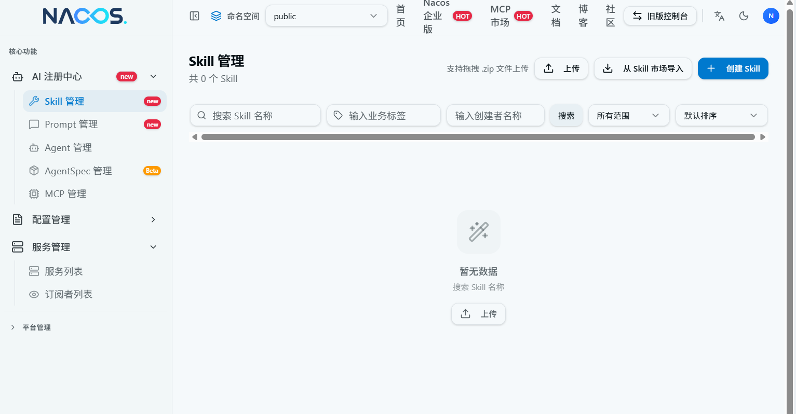
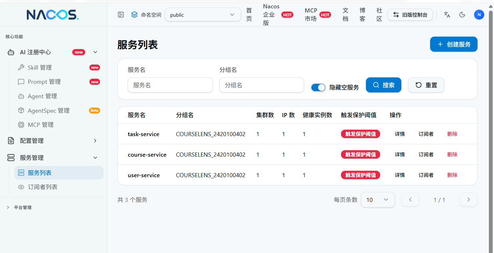
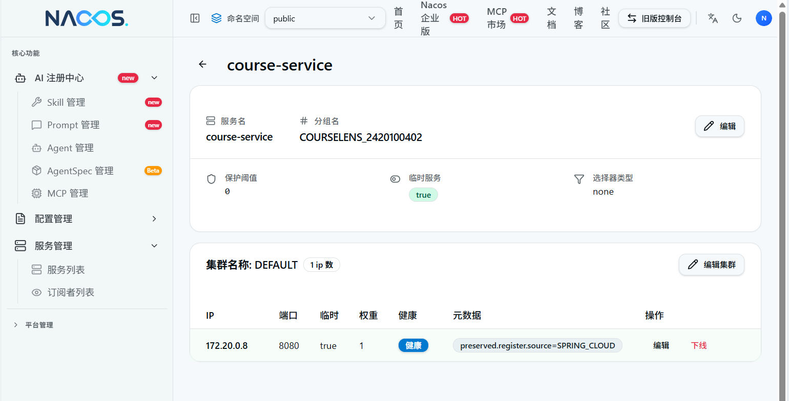

## 2. 服务发现与真实业务调用

业务顺序：POST /api/users 创建用户，POST /api/courses 创建课程，POST /api/tasks 创建处理任务。course-service 创建课程前发现 user-service，GET /api/users/{ownerId} 校验用户；task-service 创建任务前发现 course-service，GET /api/courses/{courseId} 校验课程。

每次操作均通过 DiscoveryClient.getInstances(实际服务名) 获取当前已知实例，选择一个实例，使用 instance.getUri() 拼接原业务路径发起 HTTP。保留连接 1500ms、读取 2000ms 超时，删除 USER_SERVICE_URL、COURSE_SERVICE_URL 固定地址。实例为空、发现异常或连接/超时失败返回 503；依赖资源不存在保留 404；无有效响应为 502；仅校验成功才保存本地数据。

原始截图显示任务创建 HTTP 201，发现 course-service 地址为 http://172.20.0.8:8080；创建课程时发现 user-service 为 http://172.20.0.7:8080，与课程实例详情相符。

2026-11-04 复核请求与完整响应见 [真实 HTTP 记录](evidence/live-verification.txt)，实际标识见 [复核上下文](evidence/live-context.json)：

- 用户 ID：`29e6544e-c15f-455f-84c6-c38ddf7c0118`
- 课程 ID：`32c45960-139d-4996-9cc0-98812cf80cc6`
- 首次任务 ID：`bdc84f40-e1a0-42fc-b02e-228ba5cf9c6c`
- 正常创建任务 HTTP 201，任务条数 5 → 6，增加 1。
- 不存在课程 00000000-0000-0000-0000-000000000000 返回 404，条数不变。

请求示例（将真实课程 ID 替换为当次创建结果；复核实际请求体均保存在 HTTP 记录中）：

```http
POST http://localhost:18083/api/tasks
Content-Type: application/json

{"courseId":"32c45960-139d-4996-9cc0-98812cf80cc6"}
```

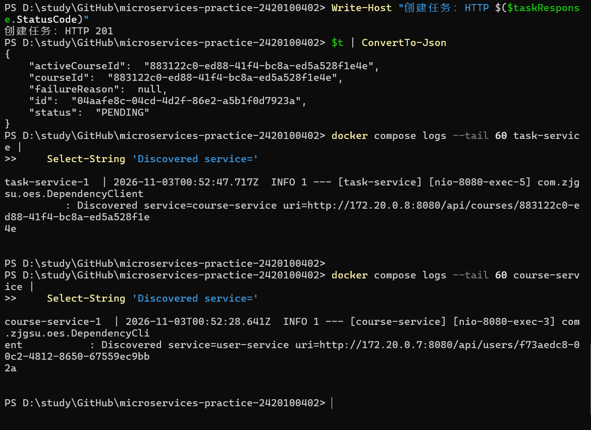

## 3. 应用健康、下线、失败不写入与恢复

三个服务的 /actuator/health 实际返回 HTTP 200、UP。保持 task-service 运行，执行 `docker compose stop course-service`，控制台列表由三个服务变成只显示 user-service 与 task-service（已开启隐藏空服务）。用同一真实课程 ID 发起新的任务创建请求，返回 503。截图中错误为 No available instance for course-service，本地任务未新增。

恢复命令为 `docker compose start course-service`，等待健康端点 UP 和重新注册后再请求，不以容器 Started 字样替代就绪。恢复后新建任务返回 201。

复核准确计数：下线请求前后 6 → 6，未写入；恢复后 6 → 7，增加 1。恢复后的任务 ID 为 `b7c0aecb-a2a0-4686-92ee-39acec48ad87`。复核任务随后依次 PATCH 为 RUNNING、SUCCEEDED，释放活动槽位。

说明：原始 08 截图虽展示新任务 201，但 PowerShell 的 `@(Invoke-RestMethod ...).Count` 将整组响应作为一项，显示新增条数为 0，不能用这个数字证明真实新增量。保留原图，不改写截图；本次用 Python len(JSON 数组) 复核，准确结果以 evidence/live-verification.txt 为准。同样对下线无写入做了真实数组计数。

SDK 连接存活表示与注册中心的通信状态；Nacos 实例健康表示注册中心当前掌握的实例可用性；Actuator 表示应用所配置健康检查的结果。调用方 UP 不保证远端依赖可用，不能假设任意 Actuator DOWN 都自动触发 Nacos 摘除。远端校验成功到本地保存之间仍存在失败窗口，注册发现不提供跨服务事务，本周不实现自动补偿。

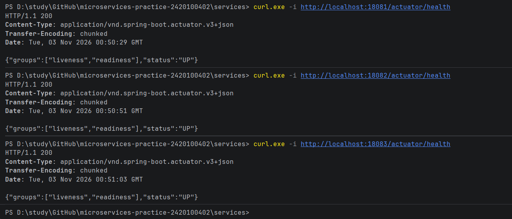
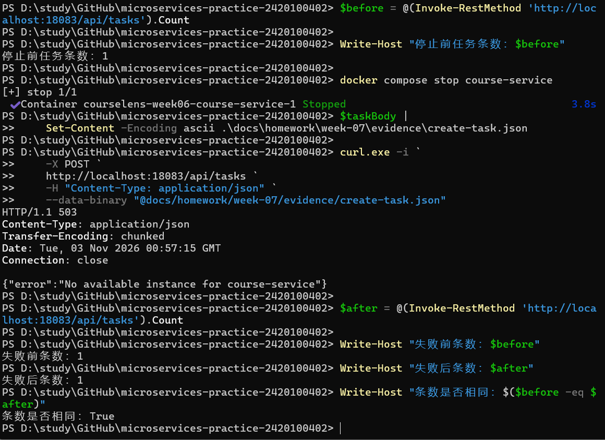
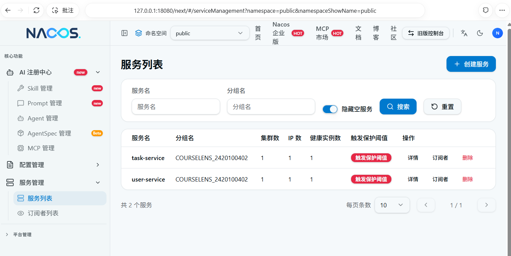
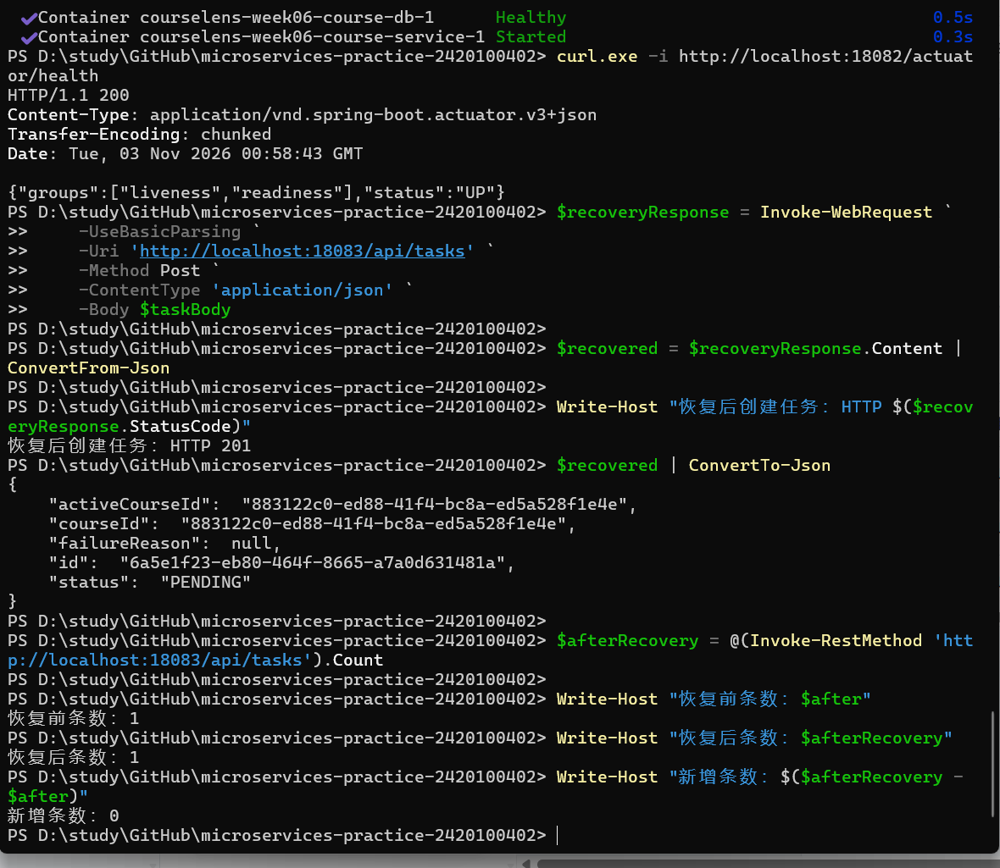

## 4. 验证脚本、自动测试与结论

根目录 Git Bash 执行：

```bash
bash scripts/smoke-test.sh
result=$?
echo "exit=$result"
```

脚本检查实际控制台 http://localhost:18080/ 返回非空 HTML，及三个业务服务的 /actuator/health 返回成功且 UP。set -euo pipefail 和显式状态检查确保失败立即退出，不忽略错误后再打印成功。

截图正常退出为 0；停止课程服务后失败退出为 7，未打印最终成功。2026-11-04 复核下线时退出码为 7，服务恢复并就绪后重新执行全部通过，退出 0。控制台与健康检查成功不能代替第 2、3 节的业务结果。

测试使用 H2，关闭真实 Nacos 发现和自动注册；两个调用方用手写 DiscoveryClient 替身及本地模拟 HTTP。覆盖空实例不写入、下一次操作重新发现、成功、404、远端错误、读取超时及既有任务约束。三个服务共 21 项测试全部通过：user 3、course 8、task 10，Failures/Errors 均为 0。进入各服务运行测试的命令见根 README。[自动测试详情](verification.md)。

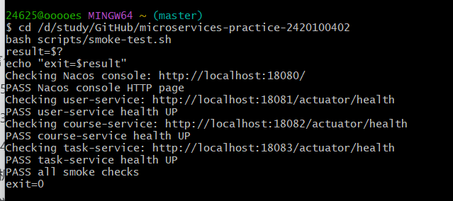
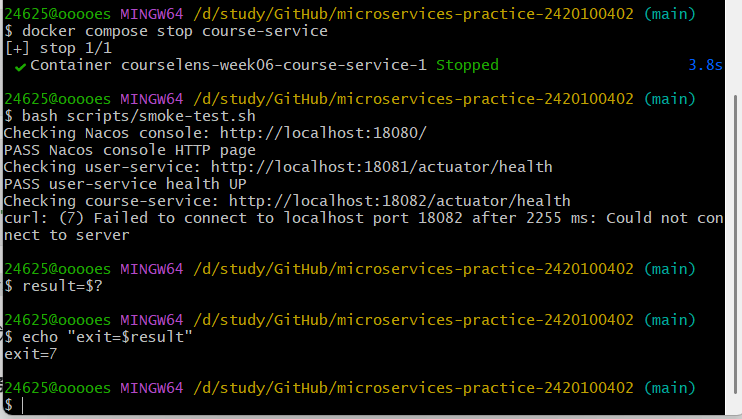
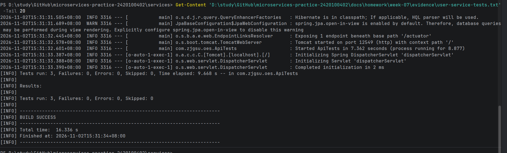
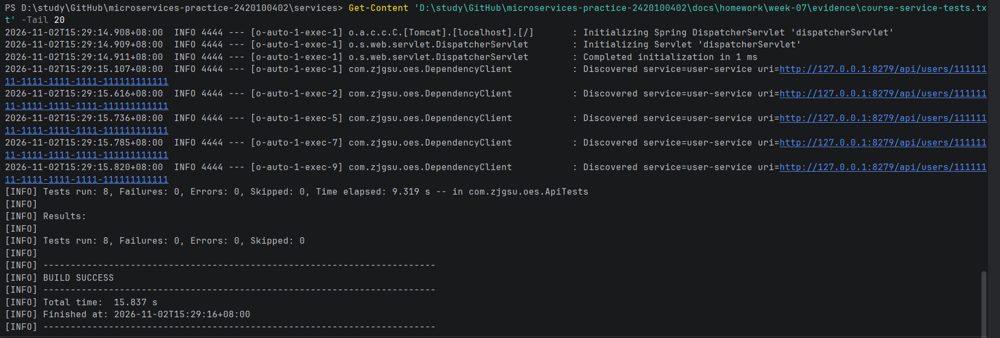
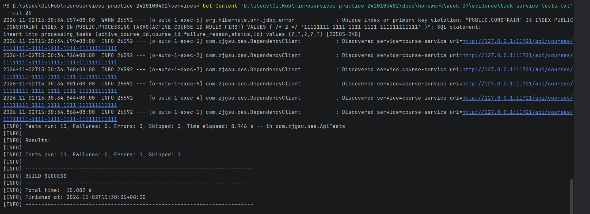

已完成注册、动态实例寻址、正常真实业务、404、服务下线后 503 且不写入、恢复后新增任务、烟测失败非零与恢复成功、21 项不依赖真实 Nacos/MySQL 的自动测试。13 张截图与补充 HTTP 证据共同归档；原始截图的计数局限已明确说明。
