# Week 07 本人实际操作截图

## 01-nacos-console.png

登录后的控制台

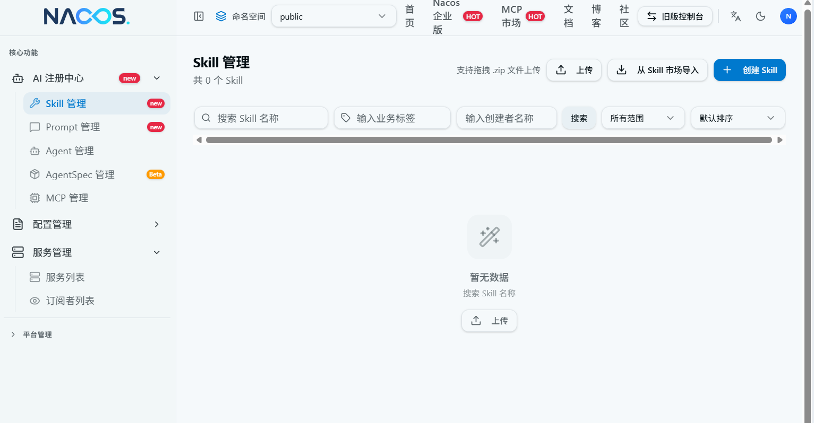

## 02-services-registered.png

三个服务及分组

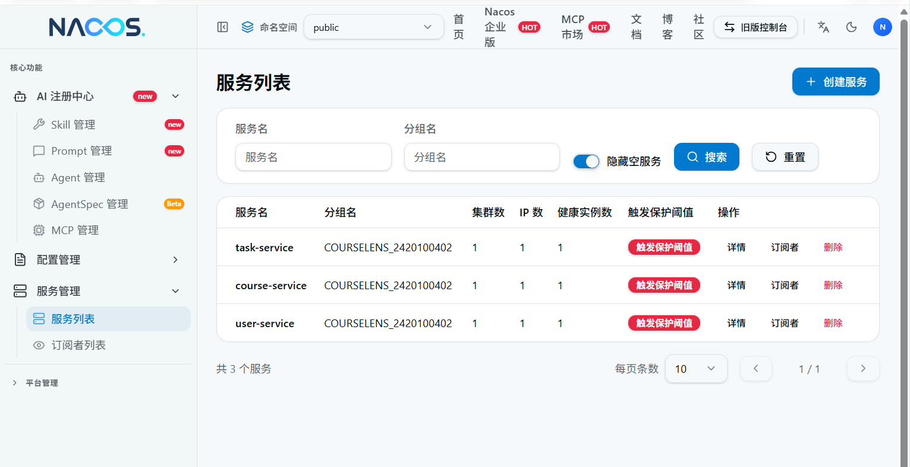

## 03-instance-detail.png

课程实例 IP、端口、健康

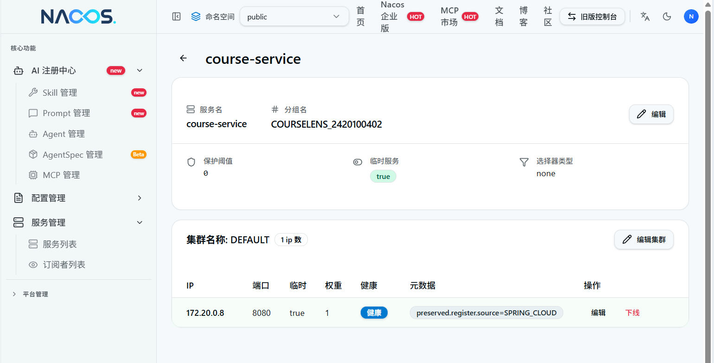

## 04-health.png

三个 Actuator 接口 UP

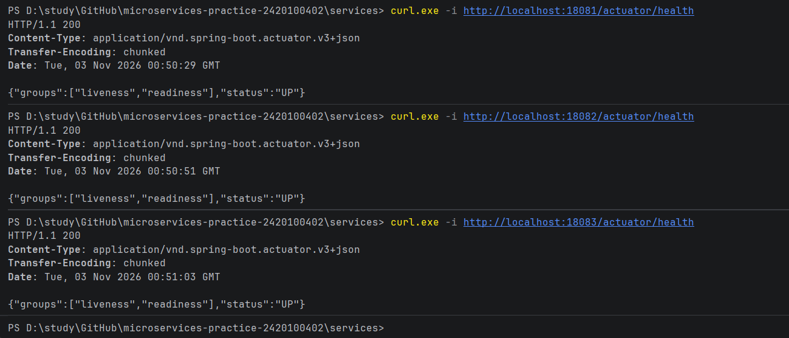

## 05-discovery-success.png

实例 URI 和真实任务 201

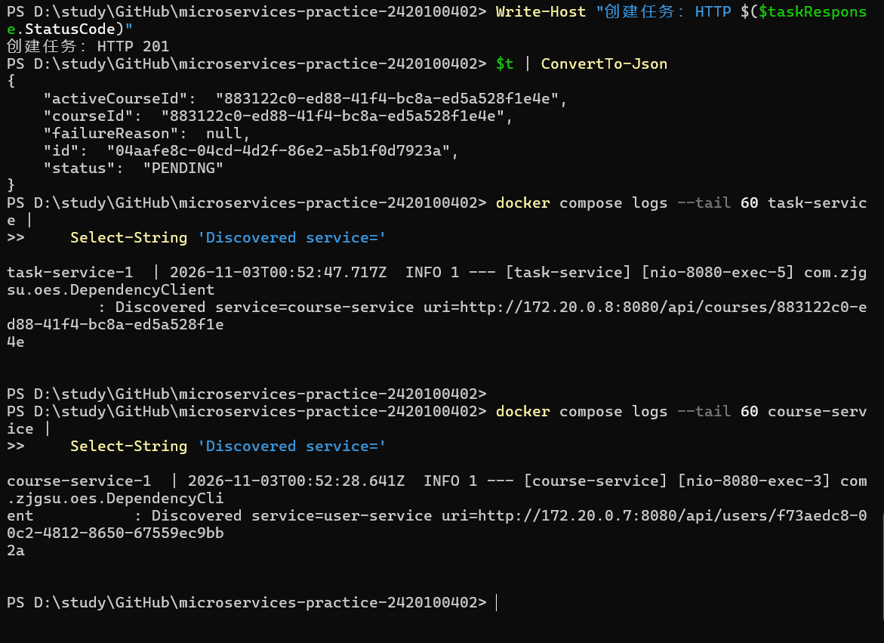

## 06-offline-503.png

停止课程服务后 503

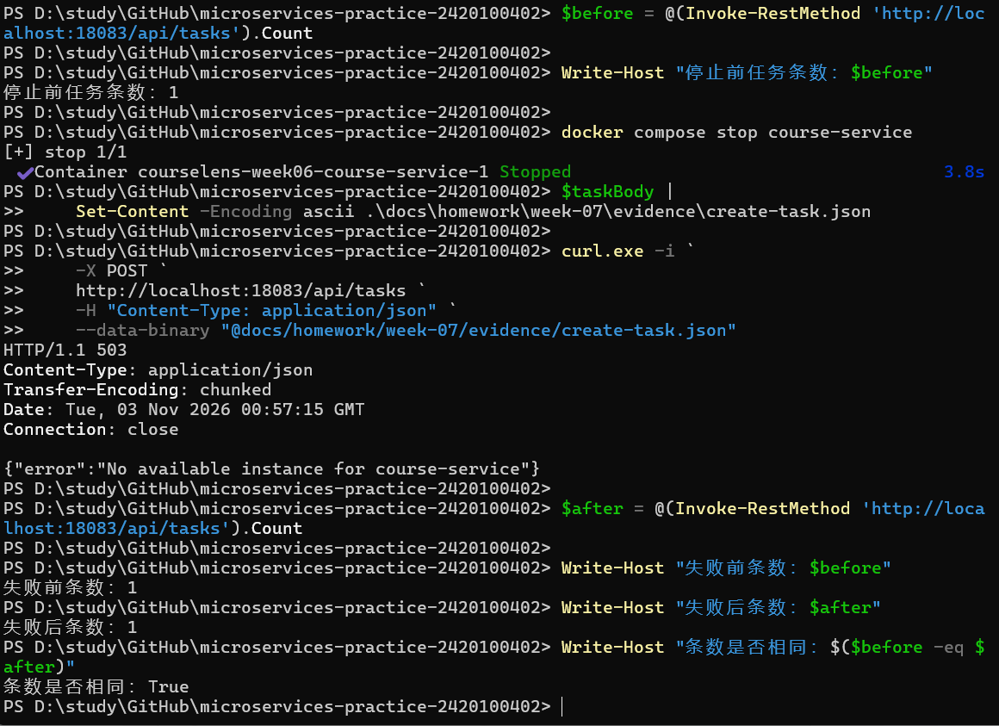

## 07-nacos-offline.png

课程服务实例下线

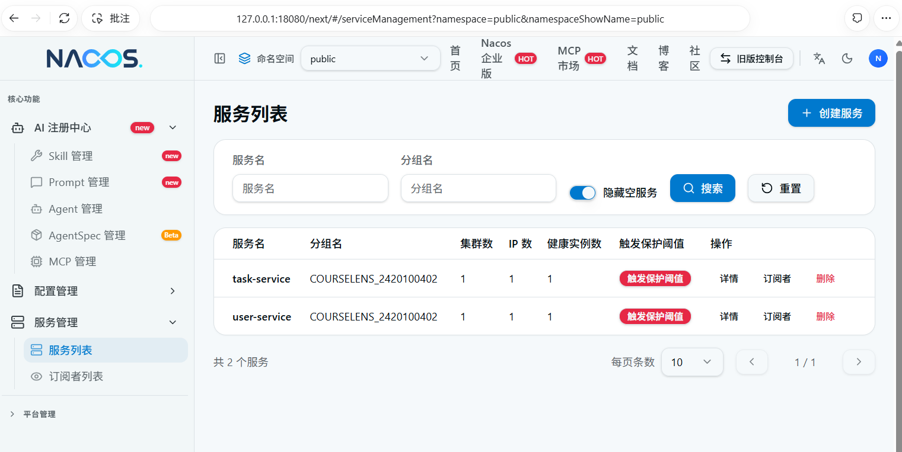

## 08-recovery-success.png

恢复后新任务 201；原始 PowerShell 计数有局限，见 index.md 复核说明

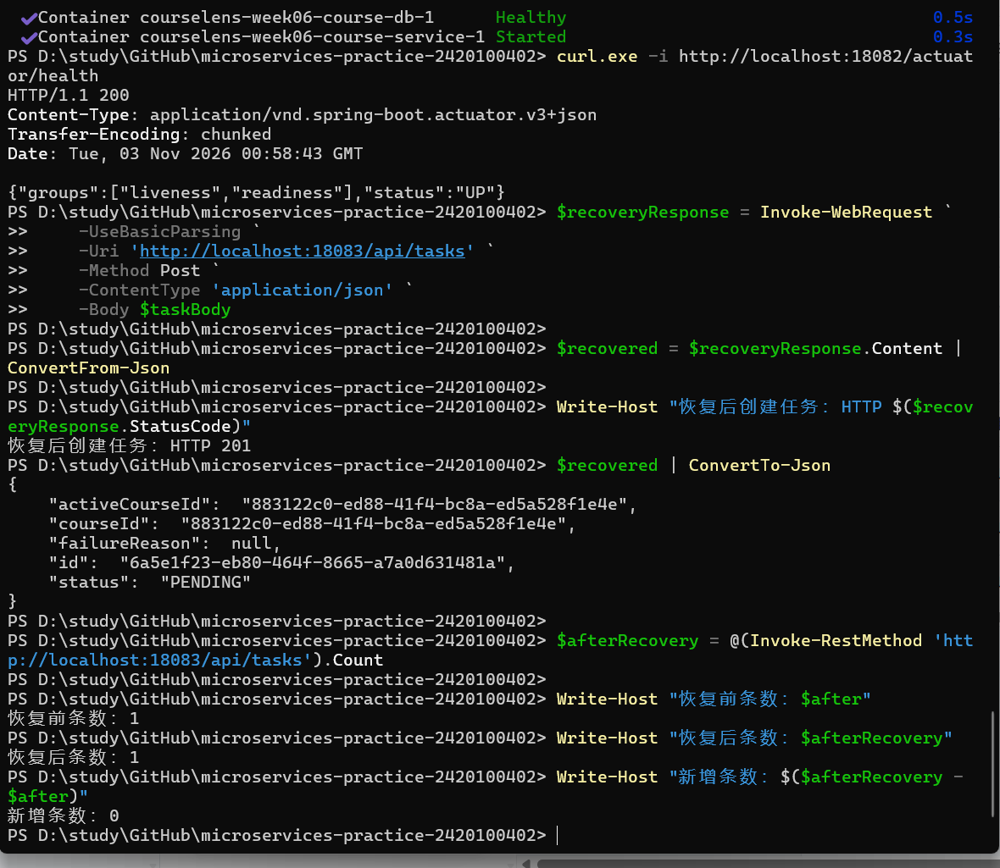

## 09-smoke-success.png

烟测成功 exit=0

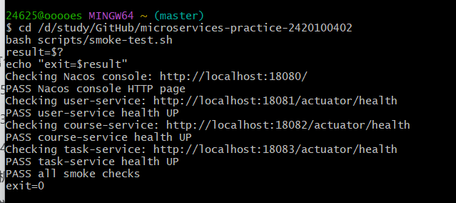

## 10-smoke-failure.png

停止课程服务后烟测 exit=7

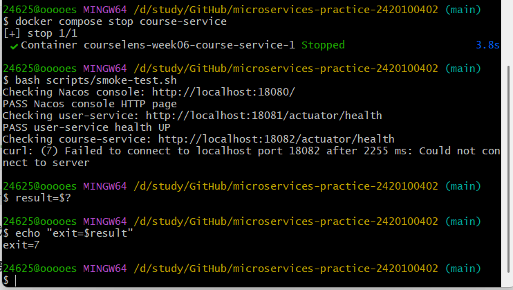

## 11-user-tests.png

用户测试 3 项

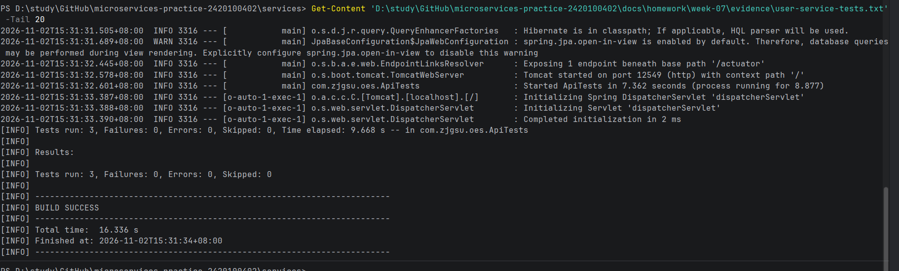

## 12-course-tests.png

课程测试 8 项

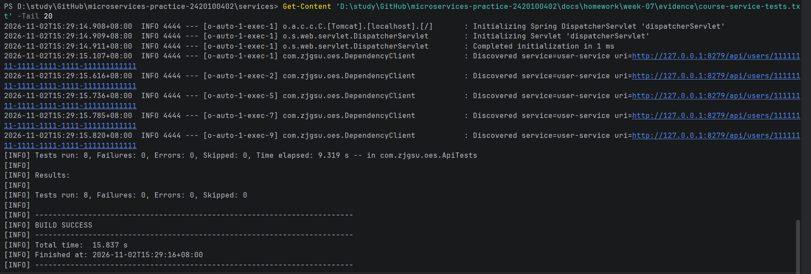

## 13-task-tests.png

任务测试 10 项

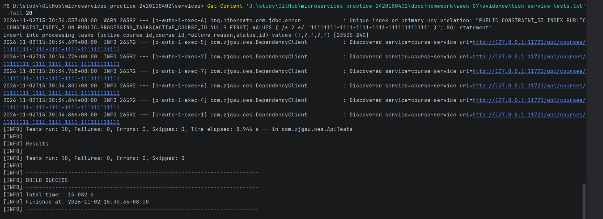
