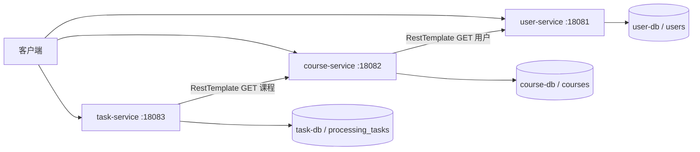
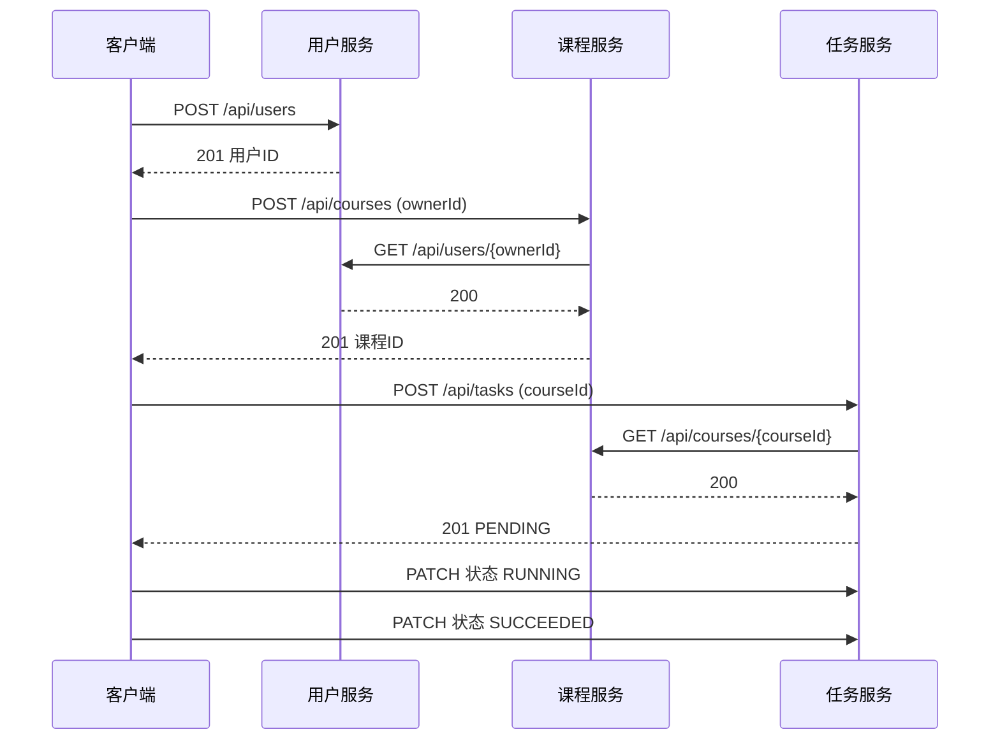

# CourseLens 服务拆分设计

第六周沿用课览的课程导入与处理任务主题，拆出用户、课程、处理任务三个独立 Spring Boot 应用。保留 `monolith/` 作为前几周的历史实现；Week 06 运行根目录 Compose 中的三个新服务，不再启动单体。

## 从单体到服务

| 原单体模块 | 新服务 | 职责 | 本机端口 / 容器端口 | 独立数据库 / 账号 | 拥有的数据表 |
| --- | --- | --- | --- | --- | --- |
| Course.ownerId 字段，原来没有独立用户模块 | user-service（新增最小用户管理） | 创建、查询用户，供课程服务验证用户存在 | 18081 / 8080 | courselens_user / user_app | users |
| CourseController、CourseRepository、CourseProcessingService 的课程方法 | course-service | 创建、查询课程；创建前调用用户 API | 18082 / 8080 | courselens_course / course_app | courses |
| ProcessingTaskController、ProcessingTaskRepository、CourseProcessingService 的任务方法 | task-service | 创建、查询处理任务，维护状态流转；创建前调用课程 API | 18083 / 8080 | courselens_task / task_app | processing_tasks |

每个服务独立 `pom.xml`、Maven Wrapper、启动类、Controller、Service、Repository、配置、SQL、Dockerfile 和集成测试。沿用原有 Spring Boot 4.0.8、Java 25。API 使用独立 JSON 记录，不共享 Java 实体包或数据库连接。

## 数据归属和调用（Week 06 历史方案）

`courses.owner_id` 只存用户 UUID；`processing_tasks.course_id` 和 `active_course_id` 只存课程 UUID。拆除原先 `ProcessingTask.course` 的 ManyToOne 和 `fk_tasks_course` 外键，跨服务只保存 ID。业务账号只能访问各自 MySQL 实例；应用不会注入其他服务的 Repository。三个实例、账号、数据卷彼此独立。

课程创建先通过 RestTemplate 执行 `GET user-service:8080/api/users/{id}`，成功后才写课程库。任务创建先执行 `GET course-service:8080/api/courses/{id}`，成功后才写任务库。地址在各自 application.yml 配置，可由 USER_SERVICE_URL / COURSE_SERVICE_URL 覆盖。连接超时默认 1500ms、读取超时 2000ms，可分别由 CONNECT_TIMEOUT_MS / READ_TIMEOUT_MS 覆盖。

依赖返回 404 时，下游返回 404；连接拒绝、读取超时或其他远端错误返回 503；远端空响应返回 502；均不会继续写本地。无效请求返回 400。任务活动槽位唯一约束使重复活动任务返回 409，终态释放槽位。任务更新通过本地事务及行锁保证状态流转。

## 业务流程与一致性窗口

顺序验证覆盖用户创建、课程导入、任务提交与状态查询。状态更新只记录调用方报告的处理结果，本周没有实现 AI 推理或转写执行器。

远端校验成功后，本地写入仍可能因数据库故障或重复活动任务而失败。这就是“远端成功、本地失败”窗口：远端查询的成功不能保证本地提交成功。当前远端操作只有读取，不需要撤销远端写操作；调用方必须检查 201/409/5xx，不能把远端 200 当作整个流程成功。前面已成功创建的用户、课程不会因后续失败被自动删除。未来若加入远端扣费等写操作，需要额外设计幂等与补偿，本周不实现跨服务原子事务、自动补偿或消息机制。

参考：[Spring Framework REST Clients](https://docs.spring.io/spring-framework/reference/integration/rest-clients.html)。本作业按题目要求使用 RestTemplate。

## Week 07：当前服务发现方案

服务名继续使用 user-service、course-service、task-service；数据归属、HTTP API、数据库和任务状态约束保留。Java 基础包统一为 com.zjgsu.oes，与既有 Maven groupId 一致。

三个服务使用环境变量配置注册中心地址、凭据、命名空间和分组。默认 public 命名空间，分组 COURSELENS_2420100402。Compose 内注册中心地址 nacos:8848。

course-service 每次创建课程时通过 DiscoveryClient.getInstances("user-service") 获取实例；task-service 每次创建任务时通过 DiscoveryClient.getInstances("course-service") 获取实例。选择一个实例的 URI 拼接原 API 路径发送 HTTP，保留连接 1500ms / 读取 2000ms 超时；不永久保存发现的地址。已移除固定地址环境变量 USER_SERVICE_URL / COURSE_SERVICE_URL。

实例为空、发现异常或连接/超时失败返回 503；依赖资源不存在保留 404；无有效响应保留 502；校验失败不写入本地数据库。SDK 连接存活、Nacos 注册实例健康、Actuator 应用健康含义不同，不能假定 Actuator DOWN 自动触发实例摘除。服务发现也不消除远端校验与本地提交间的一致性窗口。
