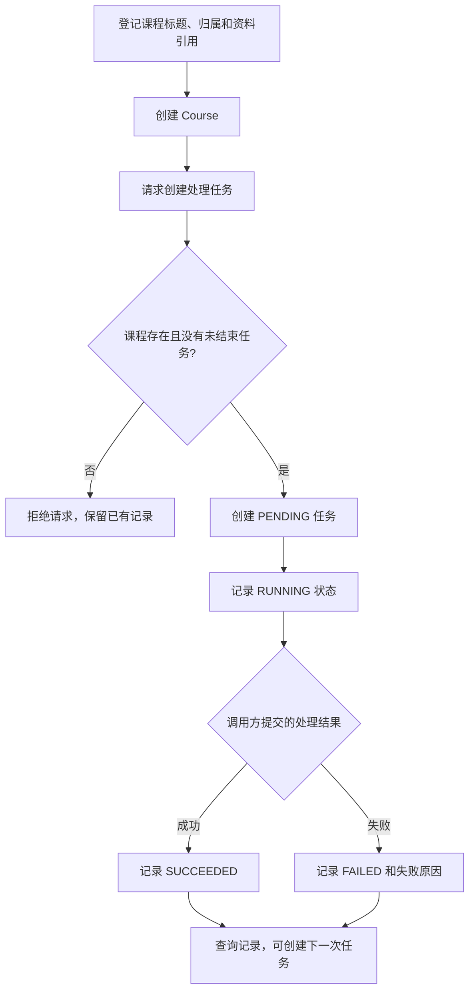
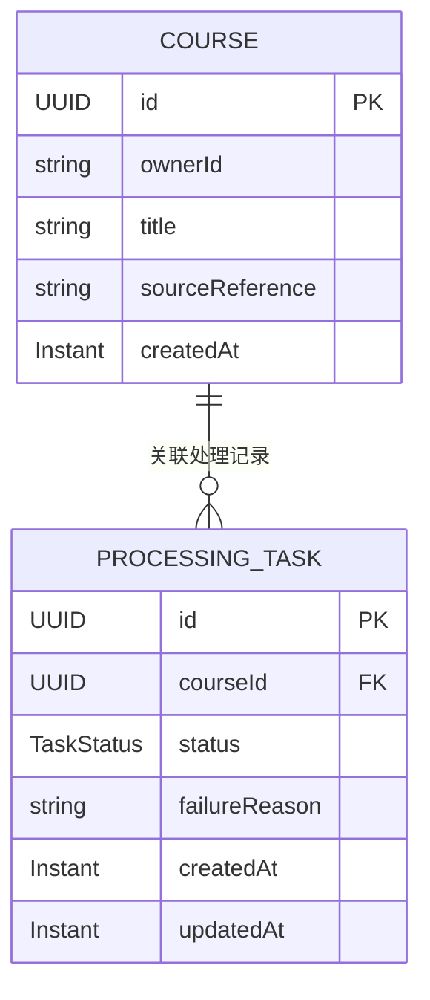
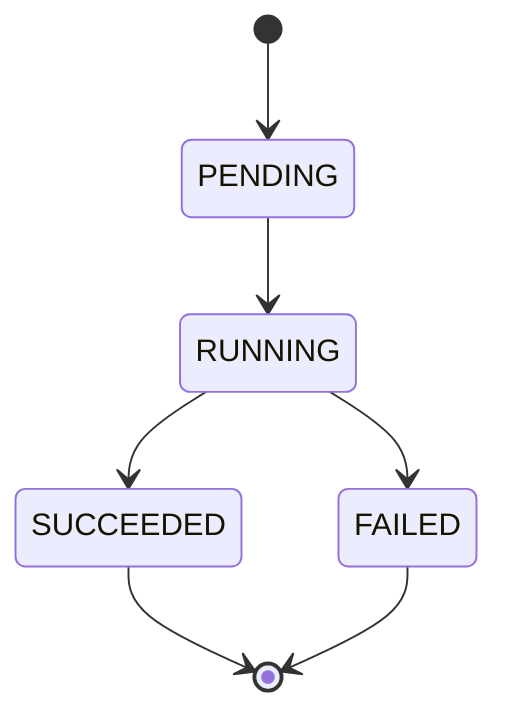

# 课览 CourseLens：项目选题简案

## 项目与目标用户

课览是一款面向视频课程的预习与可编辑笔记工作台。目标用户是需要学习高校课程、技术教程或岗位培训视频的学生与自学者，处理的素材限于本人有权使用的视频、音频或字幕。

完整目标是：学习者导入课程资料，系统处理素材并生成课程概览、章节和 AI 笔记初稿，学习者再观看、核对和修订，形成“预览 → 观看 → 修订 → 复习”的闭环。本项目中的“课程”是学习资料，不是校园选课系统中的招生课程。

## 第 04 周核心业务流程

本周实现“登记课程资料 → 创建处理任务 → 记录处理状态 → 查询处理记录”。先实现课程与任务的关系和任务创建规则，为后续转写、章节切分和笔记生成提供业务基础。

1. 学习者提供归属标识、课程标题和资料引用，Service 校验这些信息非空，创建课程记录。
2. 为已有课程发起处理请求。Service 查询该课程是否存在，以及是否已有未结束任务。
3. 没有未结束任务时，创建 `PENDING`（待处理）任务；已有待处理或处理中的任务时，拒绝重复创建。
4. 通过 Service 将任务从 `PENDING` 改为 `RUNNING`（处理中）。
5. 调用方提交处理结果：将 `RUNNING` 改为 `SUCCEEDED`（成功）或 `FAILED`（失败）。失败时必须填写原因。
6. 查询课程的处理记录。任务结束后允许创建新的处理记录，旧记录保留。

当前流程通过七个 REST 接口、真实 MySQL 和自动测试验证。资料引用是登记信息，任务结果由调用方报告；本周完成课程及任务管理，没有执行文件读取、真实转写、AI 生成或后台任务调度。

## 两类业务实体及其关系

| 实体 | 主要字段 | 职责与关系 |
| --- | --- | --- |
| 课程 `Course` | `id`、`ownerId`、`title`、`sourceReference`、`createdAt` | 描述学习者导入的课程资料。一门课程可以关联零个或多个处理任务 |
| 处理任务 `ProcessingTask` | `id`、`courseId`、`status`、`failureReason`、`createdAt`、`updatedAt` | 描述一次处理尝试，通过 `courseId` 归属于一门课程；失败原因和最终状态随该次记录保留 |

关系为 **Course 1 : N ProcessingTask**：一个处理任务只能属于一门课程，一门课程可有多条历史记录，但同一时刻最多只有一条未结束任务。

本周已通过 JPA 和 SQL 脚本建立数据库主键、外键及必要约束，详见 [数据库设计](database.md)。`ownerId` 只是课程归属元数据，本周未实现用户登录或权限校验。

## Service 中检查的业务规则

**核心规则：同一课程已有 `PENDING` 或 `RUNNING` 任务时，不允许再次创建处理任务。**

理由：重复点击处理按钮或重复提交请求，容易为同一门课程创建多条同时执行的任务，造成重复转写、重复生成和资源浪费。规则由 `CourseProcessingService.createTask` 检查：

1. 查询课程是否存在，不存在则拒绝创建。
2. 通过 `ProcessingTaskRepository.existsByCourseIdAndStatusIn` 检查已有记录。
3. 存在未结束任务时抛出 `BusinessConflictException`，不保存新任务，HTTP 返回 409。
4. 没有未结束任务时，创建新的 `PENDING` 任务。

检查与保存位于 READ_COMMITTED 数据库事务中，先以 PESSIMISTIC_WRITE 锁定课程行，再检查已有任务并写入；状态更新锁定目标任务行。数据库以 active_course_id 可空唯一键保证同一课程只有一条活动任务，结束时清空活动标识，历史记录保留。真实 MySQL 上同时提交两次创建请求，分别返回 201 和 409，只保存一条活动记录；该机制适用于共享同一数据库的应用实例，未实现跨数据库事务或消息幂等。

补充规则：课程归属、标题和资料引用不能为空；任务只能按下面的路径更新；失败原因不能为空；结束的任务不能恢复为处理中。结束后如需重新处理，创建新的任务并保留旧记录。

## 实现与验证

代码统一位于 `com.zjgsu.oes`，包括 model、repository、service、controller、dto 和 exception 包。两类实体使用 JPA 类；Repository 继承 JpaRepository，运行连接 MySQL。DTO 承载输入与响应，Controller 通过 Service 执行业务，统一异常处理输出 400、404 或 409。

七个核心 REST 接口包括课程创建、列表、详情，任务创建、历史、详情以及状态更新。真实 MySQL 实测确认 API 写入与 SQL 读取一致，应用重启后原记录保留。

自动测试使用独立 H2 自动准备数据，包括 14 个业务规则测试、5 个 Repository 测试、11 个 API 测试和 1 个启动测试，共 31 个。清理构建后执行与再次执行均全部通过。另有 19 项真实 HTTP 检查，以及真实 MySQL 并发创建验证。

第 03 周交付工程骨架；第 04 周在相同工程中完成业务建模、单体接口、数据库持久化和测试。运行命令、实际结果、截图和提交文字见 [Week 04 作业记录](homework/week-04/index.md)。文件上传、后台处理与 AI 内容生成在后续按同一业务流程继续实现。
