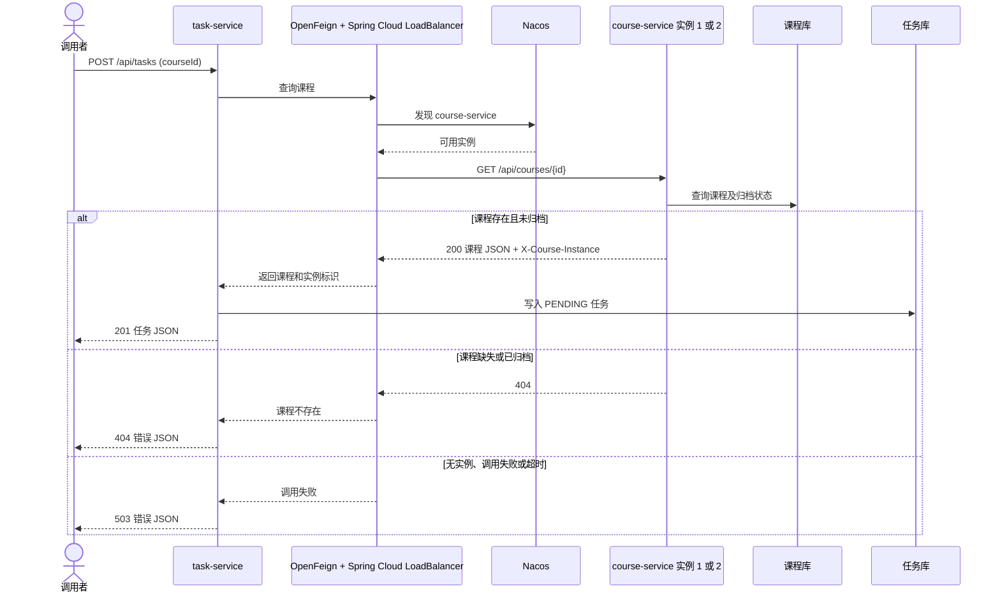

# CourseLens 服务通信

## 创建课程处理任务

用户提交已有课程的 `courseId`。`task-service` 管理任务，`course-service` 管理课程和归档状态。两个课程实例共享课程库，任务服务在自己的数据库中保存任务。

| 角色 | 工程 | 接口 |
| --- | --- | --- |
| 调用方 | `services/task-service/` | `POST /api/tasks` 接收 `{"courseId":"..."}` |
| 被调用方 | `services/course-service/` | `GET /api/courses/{id}` 返回课程 JSON，响应头包含 `X-Course-Instance` |
| 结果查询 | `services/task-service/` | `GET /api/tasks/{id}` 返回已保存的任务 JSON |

OpenFeign 使用服务名 `course-service`。两个课程容器注册同名服务，Spring Cloud LoadBalancer 从发现到的实例中轮询选择。任务服务检查响应课程 ID，再写入任务。无有效课程 ID、JSON 无法解析或收到意外的上游 4xx 时返回 HTTP 502。依赖调用失败的分支都在写入任务前结束。

课程查询是只读请求。若客户端等待 `POST /api/tasks` 响应时超时，任务可能已写入，结果未知。可通过 `GET /api/tasks` 按 `courseId` 核对，再决定是否重试。
