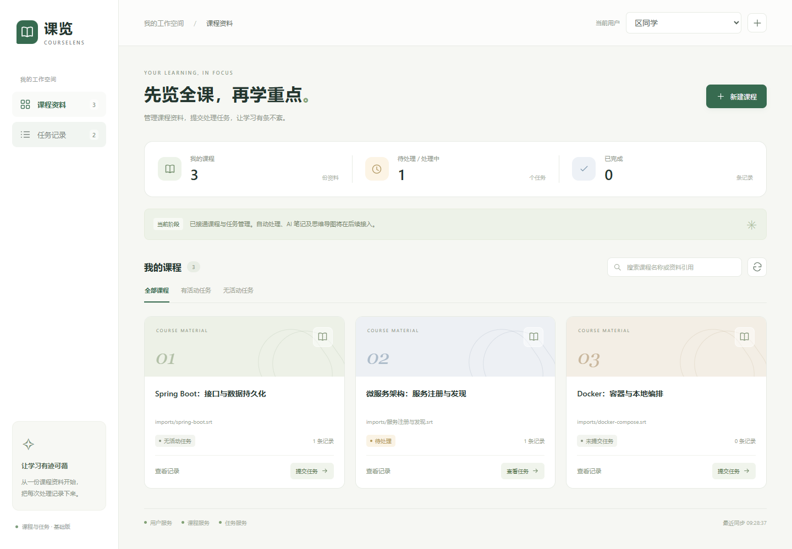
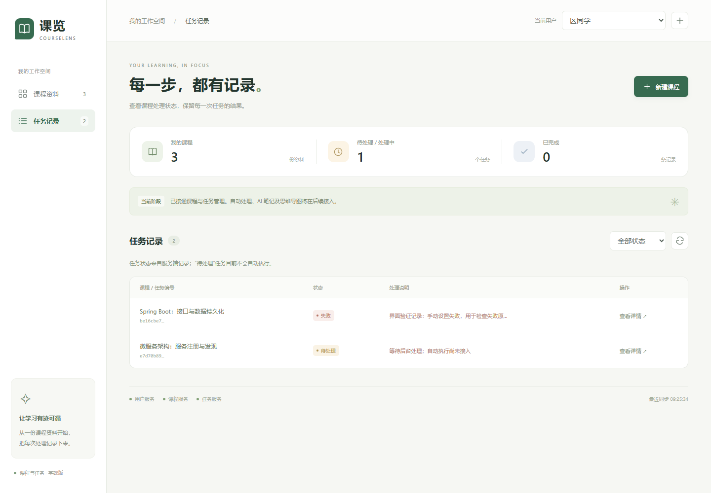
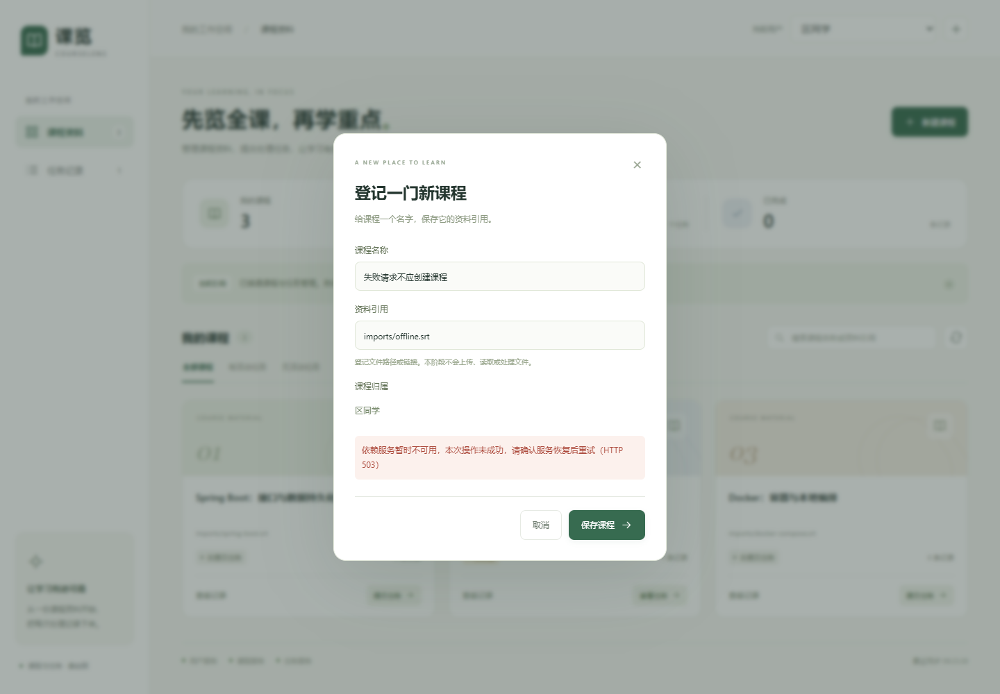
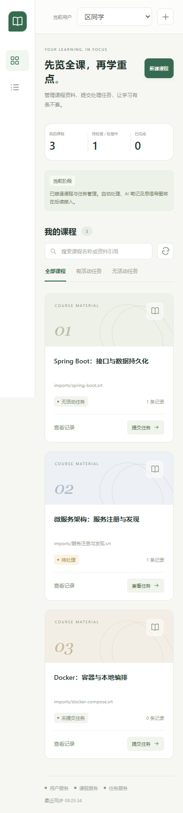

# 课览业务工作台：第一步验收

验证日期：2026-11-06。工作台地址 http://127.0.0.1:18090/，真实后端仍使用 18081/18082/18083。新增 frontend/ 与 scripts/Start-Workbench.ps1，未修改原 Java 服务、数据库结构及既有业务接口。

## 已实现

- 演示用户选择与创建，课程按 ownerId 筛选。
- 真实课程登记、资料引用、搜索、活动任务筛选。
- 提交真实 PENDING 任务、任务列表、状态筛选、失败原因和详情。
- 手动刷新、页面可见且未打开表单时每 10 秒刷新。
- 服务健康提示、请求错误、数据过期提示、提交中的禁用状态。
- 移动宽度布局与键盘可操作的原生表单/对话框。

资料引用只登记文字。尚未接入文件上传、自动执行、AI 笔记、思维导图或用户认证；无模拟完成或生成按钮。用户筛选也不提供权限隔离。

## 测试结果

`node --test`：7 项通过（1 个父测试和 6 个子测试）。代理验证页面/CSP、静态路径边界、中文 UTF-8 POST、201、404、409、Actuator 转发、405、过大请求 413、离线 503。无第三方 npm 依赖。

通过本机已有 Edge 的真实浏览器交互完成以下检查，未拦截或替换实际业务接口响应：

- PASS new user, empty course state, real userId=55f2d1f8-452c-4a8f-a01d-fe63369bbe8b
- PASS three real courses created and scoped to selected user
- PASS search and no-match empty state
- PASS real task created, PENDING displayed, taskId=e7d70b89-af8d-416d-a327-0e3668948193
- PASS stale-tab duplicate task HTTP 409 visibly explained
- PASS course activity filters, task status filters and task detail
- PASS selected user persists across reload; actual course/task data reloads from backend
- PASS course-service offline: visible 503, form input preserved, stale-data warning and write actions disabled
- PASS backend restored, failed creation produced no new course
- PASS mobile 390px viewport without document-level horizontal overflow
- PASS no browser JavaScript exceptions
- PASS real FAILED record, status filter and failure reason in task details (explicit manually-set UI verification record)

联调创建了“区同学”演示用户及三门课程，均进入现有 MySQL。第一门课程有一条真实待处理任务。为验证失败原因展示，又通过已有状态更新接口给第二门课程写入一条明确标注“手动设置失败，用于检查失败原因展示”的记录；它不代表真实文件处理。浏览器控制台无 JavaScript 异常。

课程服务停止时，新建表单显示 HTTP 503 并保留输入；刷新后显示数据过期提示并禁用相关写入。恢复后确认未误新增课程且页面恢复。下线恢复仅用于验收，最终已恢复服务。

启动脚本第一次启动及 -SkipBackend 复用已运行工作台均通过。

## 截图

## 课堂讲解路径

页面按钮 → frontend/public/app.js 的 submit 事件 → 同源 API → frontend/server.mjs 转发 → 原 Java Controller → Service → 通过 DiscoveryClient 校验依赖 → 原数据库。工作台代理只解决浏览器同源访问，不替代服务间的 Nacos 发现。

启动和操作说明见 [frontend/README.md](../../frontend/README.md)。
