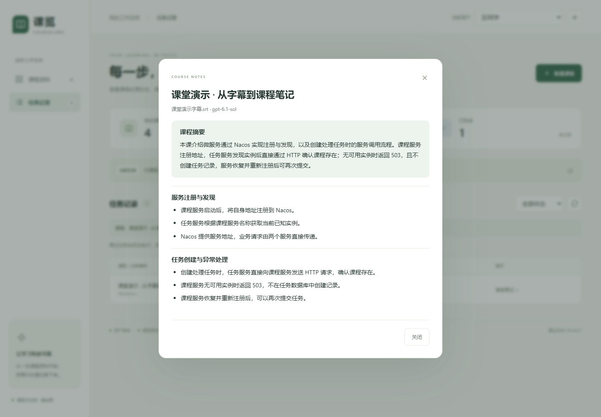

# 从字幕到课程笔记

2026-11-08 实测。工作台地址 http://127.0.0.1:18090/ 。

## 操作

选择用户和课程，在课程卡片点击「上传字幕」。选择 UTF-8 编码的 SRT、VTT 或 TXT，保存后点击「生成笔记」。生成会将该任务保存的字幕正文与课程标题发送给已配置的模型。在任务记录等待完成，点击「查看笔记」阅读摘要和知识主题。

文件最多 64 KB，清理后的字幕正文最多 7 KB。支持更换字幕，已有任务使用提交时的字幕快照。可用 [自编演示字幕](../../frontend/examples/课堂演示字幕.srt) 彩排。

## 代码路径

1. `TranscriptController` 识别字幕格式，保留字幕时间起点，清理序号和格式标签，将正文保存到课程库。
2. `NoteService.enqueue` 通过现有 `DependencyClient` 发现课程服务，读取字幕并创建笔记任务。同一门课程沿用数据库的活动任务唯一约束。
3. `NoteService.processNext` 定时领取待处理任务。事务内加行锁、记录开始时间。事务提交后由 `ModelNotes` 调用模型。结果合格时，笔记内容和成功状态一起保存。失败时保存原因，释放活动任务槽位。
4. 工作台轮询任务列表，完成后通过 `NoteController` 读取结构化笔记。早期手动任务使用原状态接口，笔记任务的状态由后台更新。

模型设置从本机 `.env` 读取。可填写 `NOTES_API_BASE_URL`、`NOTES_API_KEY`、`NOTES_MODEL` 后用启动脚本更新任务容器。Base URL 指兼容接口的根地址，例如服务提供方给出的 `/v1`，程序会追加 `/chat/completions`。本次沿用参考项目的短字幕预算、完整输出校验和本机模型配置。

## 实际验证

- 课程服务 8 项、任务服务 10 项原有测试通过，两个 Docker 镜像构建成功。
- 代理测试 7 项通过。真实浏览器上传 SRT，另用接口验证 VTT、TXT 和输入边界。错误扩展名及超长正文返回 400，缺少字幕时拒绝创建任务。
- 经用户授权用自编短字幕向 `gpt-6.1-sol` 提交一次真实生成。验收历时约 9 秒，保存课程摘要和 2 个知识主题，任务为 SUCCEEDED。
- 刷新浏览器和重启任务服务后仍读取到同一份笔记。现有课程「课堂演示 · 从字幕到课程笔记」可直接用于课堂演示。

