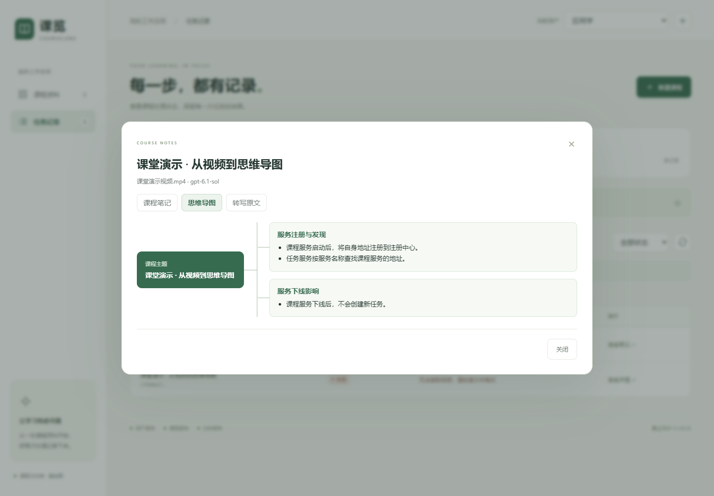
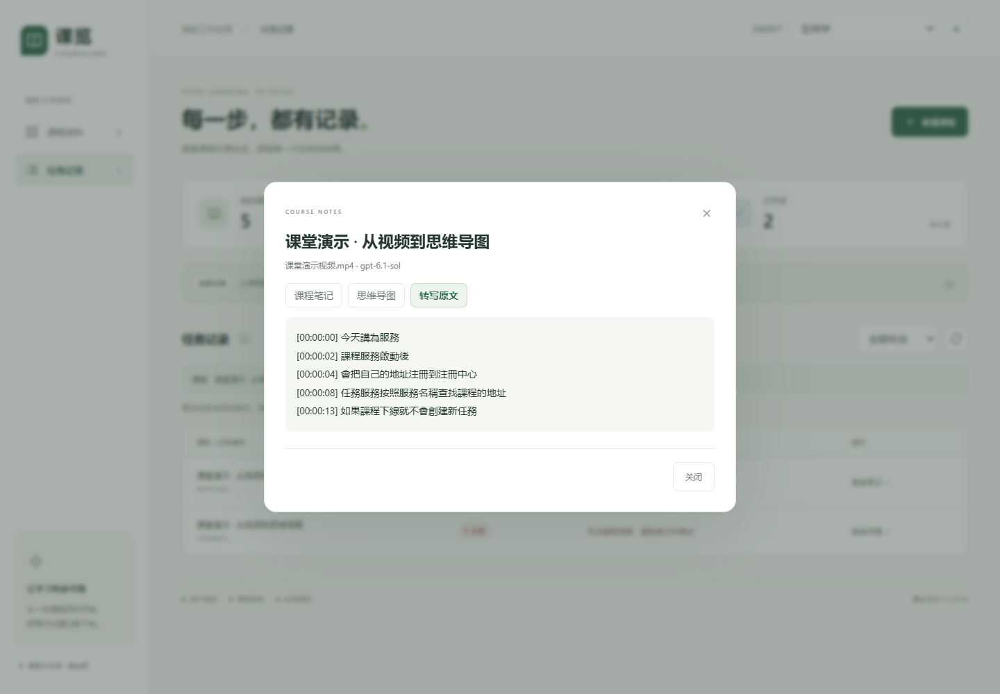

# 视频到思维导图

2026-11-08 本机验收。打开 http://127.0.0.1:18090/ ，选择「区同学」，在「课堂演示 · 从视频到思维导图」点击「打开学习页」。左侧是视频，右侧切换「课程笔记」「思维导图」「转写校对稿」。点时间标签可跳转视频。

想现场重做时，在任意无活动任务的课程卡片点「上传视频」，选择 [自制课堂演示视频](../../frontend/examples/课堂演示视频.mp4)，点击「上传并生成笔记」。任务记录会显示排队、转写、生成和完成状态。

## 实际运行

这次使用约 22 秒的自制中文 MP4，从浏览器提交到显示笔记约 27 秒。笔记模型为 `gpt-6.1-sol`，得到摘要和 2 个知识主题。导图按相同主题和要点排列。转写原文保留时间戳和模型识别文字，本次有一处同音字误识别。

- 文件格式校验和损坏视频失败路径均已实测。失败任务释放活动槽位，同一门课可再次提交。
- 已有字幕笔记也可显示导图。刷新后仍可打开结果，移动宽度下导图未发生横向溢出。
- 重启任务服务后，本机转写程序重新连接，课程笔记结果一致，容器数据卷内视频的 SHA-256 与上传文件一致。
- 任务服务原有 10 项测试、Node 代理 7 项测试通过。





## 代码路径

1. 工作台使用 multipart 上传视频。任务服务保存文件到 `video_data` 数据卷，在 MySQL 写入排队任务。
2. Windows 上的 `scripts/video_worker.py` 领取任务，使用 FFmpeg 抽出单声道音轨，并通过本机 faster-whisper CPU INT8 转写。工作进程通过令牌和短时租约提交结果。视频保存在本机，模型接口接收标题与转写文本。
3. `VideoService.complete` 保存转写快照，复用 `NoteService` 的笔记队列。成功结果与任务状态在同一事务中保存。
4. 转写按停顿和长度归并成段落。模型逐段核对同音词、术语和断句，再根据校对内容生成章节笔记。原始识别另存供对照，疑点标为「待回看」。
5. 学习页分别保存课程笔记与导图提纲。旧笔记第一次打开导图时，自动提取简短的主题和要点。点「编辑正文」或「编辑导图」，可在原位置修改。选中文字后可在文具栏添加下划线、波浪线或多色高亮；导图内可增删分支、调整颜色。点击「保存修改」后，保存当前视图的内容。时间标签用于跳转本地视频；浏览器无法解码时可以下载原视频。
6. 「重新校对并生成」从原始转写另起任务，旧笔记可继续打开。课程卡片的「更多操作」提供删除，删除后工作台隐藏这门课及其任务，已有文件与结果保存在本机。

在课程卡片点「链接转写」，或点首页「从 B 站导入」新建课程。可以粘贴带标题的整段分享文字、普通视频链接或 b23.tv 短链。确认分集预览后，可选单集或整个合集。合集在任务记录中显示每集进度并逐集处理；各集有自己的学习页。单集失败时队列继续，停止排队会保留已经开始的分集。

本地上传支持 MP4、MOV、WebM、MKV，最长 60 分钟、最大 1 GB。长视频按约 5 分钟分段转写，时间戳沿用视频中的位置。较长的转写正文分批生成笔记，按时间合成一份结果。转写正文最多 512 KB。本机复用 BiliNote 的 Python 环境及 FFmpeg，并使用本地 Whisper tiny 权重。转写实现参考 [faster-whisper 官方项目](https://github.com/SYSTRAN/faster-whisper)。

## 启动

在仓库根目录 PowerShell 执行：

```powershell
powershell -ExecutionPolicy Bypass -File .\scripts\Start-Workbench.ps1
```

脚本会启动工作台、业务服务及本机转写程序。本机路径和工作进程令牌在忽略的 `.env` 中。换电脑时填写 `VIDEO_PYTHON`、`VIDEO_FFMPEG`、`VIDEO_WHISPER_MODEL` 和新的 `VIDEO_WORKER_TOKEN`，Python 环境需安装 faster-whisper；使用 B 站链接时还需安装 yt-dlp，FFprobe 与 FFmpeg 放在同一目录，模型目录包含转换后的权重及 tokenizer 文件。

升级版的多平台链接、术语表、失败重试、详略选择、桌宠和导出见 [工作台升级与验收](workbench-upgrade.md)。
